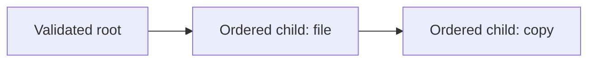

# FEAT-01: Command Model

## Status
**ACTIVE**

## Capability
Represent an immutable command tree with validated names, aliases, metadata,
unique canonical ancestry, and deterministic command-path selection.

## Context
The command-selection behavior is defined below. The approved model schema
and validation boundary are recorded in
[ADR-003](../Architecture/ADR-003-Definition-Model.md); parser ordering is
recorded in [ADR-004](../Architecture/ADR-004-Parser-And-Conversion-Pipeline.md).

## Requirements
### FEAT-01-001 - Hierarchy and metadata
The model must represent a root, ordered children, names, aliases, and descriptive metadata.
**Acceptance:** A root with `file` and its child `copy` preserves their metadata and hierarchy; an empty child list is valid.
**Security:** Metadata is untrusted display data, not executable markup or authority.

### FEAT-01-002 - Definition integrity
The model must reject empty names, cycles, reused command nodes, and sibling name/alias collisions under ordinal case-sensitive comparison.
**Acceptance:** Sibling `copy` and alias `copy`, a self-child, a node attached beneath two parents, and an empty name fail model validation; unrelated branches may reuse a name.
**Security:** Reject ambiguous or cyclic graphs without unbounded traversal or selecting an arbitrary handler.

### FEAT-01-003 - Deterministic path selection
For valid input select a root-to-command path using declared names or aliases; preserve the canonical selected command regardless of spelling.
**Acceptance:** `file cp` selects `root/file/copy` when `cp` aliases `copy`; a command with children and a positional binds a nonmatching token as that positional, while a group without positionals reports an unknown command.
**Security:** An unknown routing token or ambiguous name must not invoke a fallback command; intentionally declared positional binding follows the explicit precedence below.

## Design
#### Command selection

The root name is a display label and is not included in argv. Starting at the
root, an unconsumed bare token selects an exact child name or alias while
command selection remains open. Selection closes permanently after the first
positional token or `--`; option values and positional values are never
reinterpreted as command names.

When a command has both children and positional definitions, an exact child
match wins and a nonmatching bare token binds as a positional. When a command
has children but no positionals, a nonmatching bare token is an
`UnknownCommand`. Hidden commands remain selectable by exact name or alias;
visibility affects help and completion, not routing or authorization.

## Metrics Impact
**Instruments:** none - immutable definition validation does not add runtime metrics.

## Verification
Portable tests in `tests/Mauve.Cli.Tests/Definitions/CommandModelTests.cs`
cover metadata snapshots, order, empty children, collisions, cycles, and
multiple-parent reuse. `CliParserTests.Parse_SelectsCanonicalCommandPathsAndHonorsAliasesAndPositionals`
covers alias selection, canonical paths, and child-versus-positional
precedence. Test-run evidence is recorded separately in the
[validation ledger](../validation-gaps.md).

## Diagrams

