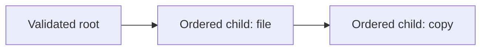

# FEAT-01: Command Model

## Status
**ACTIVE**

## Capability
Represent an immutable command tree with validated names, aliases, metadata,
and unique canonical ancestry.

## Context
The [planned command-selection requirement](Planned/FEAT-01-Command-Model.md)
depends on this model and remains planned until argv parsing is implemented.
The approved schema and validation boundary are recorded in
[ADR-003](../Architecture/ADR-003-Definition-Model.md).

## Requirements
### FEAT-01-001 - Hierarchy and metadata
The model must represent a root, ordered children, names, aliases, and descriptive metadata.
**Acceptance:** A root with `file` and its child `copy` preserves their metadata and hierarchy; an empty child list is valid.
**Security:** Metadata is untrusted display data, not executable markup or authority.

### FEAT-01-002 - Definition integrity
The model must reject empty names, cycles, reused command nodes, and sibling name/alias collisions under ordinal case-sensitive comparison.
**Acceptance:** Sibling `copy` and alias `copy`, a self-child, a node attached beneath two parents, and an empty name fail model validation; unrelated branches may reuse a name.
**Security:** Reject ambiguous or cyclic graphs without unbounded traversal or selecting an arbitrary handler.

## Metrics Impact
**Instruments:** none - immutable definition validation does not add runtime metrics.

## Verification
Portable tests in `tests/Mauve.Cli.Tests/Definitions/CommandModelTests.cs`
cover metadata snapshots, order, empty children, collisions, cycles, and
multiple-parent reuse. Test-run evidence is recorded separately in the
[validation ledger](../validation-gaps.md).

## Diagrams

