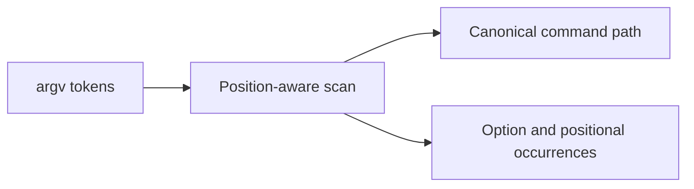

# FEAT-03: Token Grammar

## Status
**ACTIVE**

## Capability
Interpret a caller-provided argument vector without changing token boundaries.

## Context
Depends on [FEAT-01](FEAT-01-Command-Model.md),
[FEAT-02](FEAT-02-Options-And-Arguments.md), and
[FEAT-15](FEAT-15-Directives.md). The parser and conversion
pipeline is recorded in [ADR-004](../Architecture/ADR-004-Parser-And-Conversion-Pipeline.md).
Ancestor options are not implicitly visible; inherited and global option
scope is owned by [FEAT-12](FEAT-12-Inherited-And-Global-Options.md).

## Requirements
### FEAT-03-001 - Argument vector boundary
The parser consumes caller-provided tokens without reinterpreting shell quoting or splitting embedded spaces.
**Acceptance:** One token `a b` remains one value; an empty token is preserved, and an empty vector selects the root.
**Security:** The parser never executes tokens or invokes a shell; quoting and escaping before argv construction are the caller's responsibility.

### FEAT-03-002 - Option forms and values
The parser recognizes declared long and short names in space-separated and equals forms using configured prefixes, and reports a missing required value without consuming the fixed `--` end marker.
**Acceptance:** With default syntax `--count=2`, `--count 2` and `-c 2` bind alike; custom prefixes are honored; `--count --` reports a missing value; unknown options are not silently accepted.
**Security:** Preserve token boundaries and reject malformed input instead of guessing a value for an unrelated option.

### FEAT-03-003 - Command and option ordering
Track consumed token positions when resolving the command path and binding inputs, so equal text elsewhere is not mistaken for a command.
**Acceptance:** For child `copy`, `copy --name copy` keeps the second `copy` as the option value; an option before a child consumes its required value only once.
**Security:** Selection must not change based on duplicate text in a value or skip validation of an unconsumed token.

### FEAT-03-004 - Dash and end marker
The parser treats `--` as the end of option and command recognition; subsequent tokens are positional, including dash-prefixed literals.
**Acceptance:** `-- -file` binds literal `-file`; a required numeric option accepts `--count=-2`; an unrecognized dash token before `--` is reported.
**Security:** Do not reinterpret a literal after `--` as an option or command; report excess positionals.

## Design

The parser receives argv without the executable name and preserves empty
tokens and embedded whitespace. It does not tokenize shell syntax, expand
response files, substitute environment variables or split comma-separated
values. It recognizes the first `=` in an option token as the only inline
value separator.
Invocation-time option environment binding is a separate whole-value input
source owned by [FEAT-16](FEAT-16-Environment-Option-Binding.md); it does not
rewrite or expand argv tokens.

An unconsumed bare token may select an exact child name or alias while
command selection is open. Once a positional or `--` closes selection, later
text cannot select another command. The parser records each consumed token's
original index and rechecks local option ownership against the final command.
An ancestor option is not inherited implicitly. Root directives are
recognized before the first child-command token; after selecting a child,
bracket-looking tokens are ordinary input and cannot dispatch directives.

Option values are consumed by token position. A value that happens to equal a
child name remains a value; the parser does not skip it or search later text
for an earlier command. Once a command is selected, subsequent equal text is
bound according to the selected command's option and positional definitions.

Required values stop before `--` and option-like tokens. A numeric definition
may consume a negative candidate beginning with `-` and an ASCII digit, or
`-.` followed by a digit; conversion then decides whether it is valid.
Optional scalar values require an inline `=` value or use the declared bare
policy. Boolean flags consume a following `true` or `false` token before
command or positional matching. Prefixes are configured independently of
option names; the exact token `--` always ends option and command recognition.
Short clusters are expanded only when every character selects a declared
zero-token option; unknown or value-taking cluster members reject the whole
cluster without partially applying it.

## Metrics Impact
**Instruments:** none - token parsing adds no runtime instrumentation.

## Verification
Portable behavior tests are declared in
[`CliParserTests`](../../tests/Mauve.Cli.Tests/Parsing/CliParserTests.cs):
argument-boundary, missing-value, command-text, consumed-token ordering and
end-marker scenarios, including
`Parse_TracksConsumedCommandAndValueTokenPositions`.
No product test-run evidence has been imported as Governance evidence; local
suite results are recorded in the [validation ledger](../validation-gaps.md).

## Diagrams

