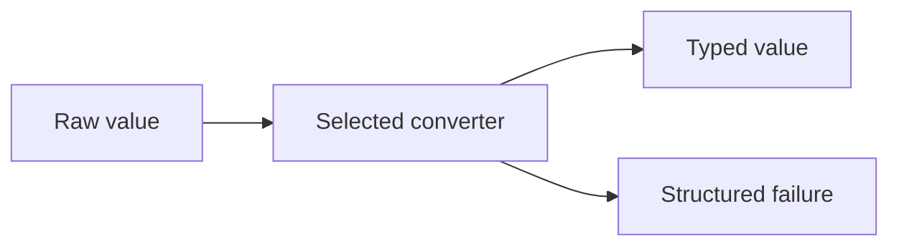

# FEAT-04: Typed Conversion

## Status
**ACTIVE**

## Capability
Convert input values to declared types through predictable built-in or
explicitly registered conversion.

## Context
Depends on [FEAT-02](FEAT-02-Options-And-Arguments.md) and
[FEAT-03](FEAT-03-Token-Grammar.md). Results and error presentation belong
to [FEAT-07](FEAT-07-Parse-Results-And-Diagnostics.md). Reference:
the accepted pipeline in
[ADR-004](../Architecture/ADR-004-Parser-And-Conversion-Pipeline.md),
`../maz/Console/Cli/Parsing/CliParser.cs` and
`../maz/specs/CLI Parser Specification.md`.
Model/definition ownership and C# unions are specified by
[ADR-015](../Architecture/ADR-015-Converter-Ownership-And-Unions.md).

## Requirements
### FEAT-04-001 - Built-in types
Provide a documented supported set covering strings, booleans, numeric primitives, enums, paths, date/time and nullable forms; reject unsupported conversion metadata before input conversion.
**Acceptance:** Convert `42` to an integer, a declared enum name to its member, and distinguish an absent nullable value from invalid input; unsupported types cannot parse accidentally.
**Security:** Reject overflow, invalid enum values and malformed input rather than silently coercing them.

### FEAT-04-002 - Culture
Use a documented deterministic culture policy and support an explicitly selected culture where applicable.
**Acceptance:** Under a different process locale, invariant `1.5` still converts identically by default; an explicitly supplied supported culture controls its own decimal form.
**Security:** Do not allow ambient locale changes to silently alter validation or authorization-related values.

### FEAT-04-003 - Registered converters
Allow definition-local, model-wide and host type converters without runtime assembly scanning. Support ordered C# union case conversion through statically referenced registrations, with deterministic precedence and configuration-time conflict handling.
**Acceptance:** A registered converter binds a custom value; conflicting registrations and an unsupported unregistered type are rejected.
**Security:** Treat converter code as application-owned; report returned conversion failures without exposing raw input, and never turn a thrown callback fault into successful default-valued input.

### FEAT-04-004 - Conversion failure
Represent failure with stable structured context identifying the definition and occurrence, without treating failed input as a default.
**Acceptance:** Invalid numeric text and overflow yield conversion errors, not zero; repeated runs give the same category and location.
**Security:** Public diagnostics must not echo potentially secret input; constrain diagnostic detail.

## Design
#### Supported conversion table

One conversion pipeline serves scalar options, collection elements and
positionals. Input is a complete raw token/string, never a split CSV list.
Use nonthrowing framework parsing where available; model validation resolves
the converter before any argv is processed.

| Target | Proposed accepted input / restrictions |
| --- | --- |
| `string` | Preserve all characters, including whitespace and empty text. |
| `bool` | `true`/`false`, ordinal case-insensitive. Not `0`, `1`, `yes` or empty. Bare/negated flags are FEAT-05 syntax, not converter guesses. |
| Fixed-width integers | `sbyte`, `byte`, `short`, `ushort`, `int`, `uint`, `long`, `ulong`; decimal digits and optional leading sign, no thousands/currency/hex/whitespace; reject overflow. |
| `float`, `double` | Decimal/exponent input with optional ASCII sign; allow `.5`, `5.` and `-.5`; invariant decimal point by default, no grouping/whitespace; reject NaN, infinity and overflow to infinity. |
| `decimal` | Decimal/sign input without grouping, currency, exponent or whitespace; reject overflow. |
| `Guid` | Dashed `D` format only, case-insensitive hex; no whitespace. |
| `Uri` | Explicit RFC-style scheme prefix plus well-formed absolute URI; reject implicit local/UNC paths and drive-path forms (`/etc/x`, `//host`, `C:\\x`). Syntax validation is not authorization or a network request; allowed schemes/hosts are application validators. |
| `Half` | Same decimal/exponent grammar as float/double; finite values only. |
| `char` | Exactly one non-surrogate UTF-16 code unit. Use an explicit converter for a Unicode scalar (`Rune`). |
| `DateOnly` | Exact `yyyy-MM-dd`; calendar-invalid dates fail. |
| `TimeOnly` | Exact `HH:mm`, `HH:mm:ss`, or `HH:mm:ss` plus 1-7 fractional digits. |
| `DateTimeOffset` | ISO date and time with explicit `Z` or numeric `+/-HH:mm` offset; no ambient local-time interpretation. |
| `TimeSpan` | Invariant constant `c` format; surrounding whitespace is rejected. |
| `Version` | Two to four unsigned ASCII decimal components; component overflow fails. |
| `IPAddress` | Strict four-component IPv4 dotted decimal, without leading-zero/octal/hex/abbreviated forms, or IPv6 text; no bracket wrapper or surrounding whitespace. |
| `FileInfo`, `DirectoryInfo` | Nonempty lexical paths valid for the current platform; no existence/access/kind checks, creation, or filesystem I/O. |
| Enum | Declared member name, ordinal case-sensitive; no numeric values, implicit description aliases or comma-combined flags. A named flags constant is valid. |
| `Nullable<T>` | Convert nonempty supplied input with T's converter. Empty numeric/enum input is invalid, not null. Null comes from absence/bare/default policy, not the text `null`. |
| C# union | Ordered statically registered case conversions; first success wins, all returned failures produce `union.no-match`, and thrown callback faults abort. |
| Other types | Require explicit converter registration. `DateTime`, `nint`/`nuint`, `BigInteger`, `Rune`, arbitrary constructors and reflection-discovered `Parse` are not built-ins. |

Explicit culture opt-in affects decimal separator in numeric conversion only;
retain all other style restrictions and reject culture-specific grouping.
Freeze the chosen culture/provider in parser settings for an operation.
Never read the ambient process culture during conversion. The default is
invariant, including in generated code.
Integers use invariant ASCII signs/digits only. Floating styles are
AllowLeadingSign | AllowDecimalPoint | AllowExponent; decimal omits
AllowExponent and accepts `.5`/`5.` too. Prevalidate ASCII signs/digits and
use a clone of invariant NumberFormatInfo changing only NumberDecimalSeparator.
No custom culture signs/grouping enter the grammar. FEAT-03's negative-value
routing remains ASCII and invariant-dot-based; `-,5` in a comma-decimal
culture must use inline equals (`--ratio=-,5`). `-Infinity` also requires
equals to reach conversion, where it is rejected.

#### Converter contract and selection

Resolution algorithm: first a definition/element-specific converter;
second an exact registered converter for the declared target (including
Nullable<T>); third, for Nullable<T>, repeat type-registry/built-in resolution
for T; otherwise use the built-in. Thus a registered int converter also
serves int? unless an exact int? or definition override exists.
Two registrations for the same key are an invalid model, not last-wins.
Root `CommandBuilder.RegisterConverter`/`AddConverters` snapshot a model-wide
registry. `CliHostOptions.Converters` and lower-level parser/completion
constructors supply host registrations. Duplicate model/host exact keys throw
before conversion. Runtime model creation validates override target types;
operation configuration additionally checks supported types against the
complete model/host registry before parsing values.

`ValueConverterRegistration.Create<T,TProvider>()` supplies a typed local
override. `ICliValueConverter<T>` references a static provider; delegates remain
supported. Generated property annotations target the exact scalar or element
type; type annotations register the underlying custom type automatically.

`RegisterUnion<TUnion>` requires ordered unique typed case factories. Case
conversion uses the same type registry and culture. Numeric case metadata
allows invariant negative-numeric value routing. Catch-all string cases should
come last. Recursive or unsupported case dependencies fail before callbacks.
Generated roots discover only compiler union declarations in source; other
union representations need explicit case registration or one custom converter.
BooleanFlag's intrinsic literal parser
is FEAT-02/05 syntax, not an overridable registry conversion; this resolution
algorithm applies to actual supplied scalar/element values.
Collection containers never fall through to conversion of
the last element.

A converter receives the raw scalar and immutable culture/definition context
and returns either one typed value or a structured failure with a safe reason.
It must not mutate definitions or previous results. Applications own any
external side effects and lifetime of custom objects; converters used in
concurrent parses must be thread-safe or constructed per operation.
Returned null is valid only for a nullable target explicitly allowing it.
AllowsNull metadata covers reference types as well as Nullable<T>.
Absence/bare behavior never invokes a value converter. An explicit empty
token goes to the selected converter: built-in nullable numeric/enum
conversion fails, but an explicitly registered nullable converter may define
another outcome. A null result for AllowsNull=false is InvalidValue.

Built-ins use compile-time-typed registrations/generated delegates, not
MakeGenericType or runtime assembly/type discovery. For enums the generated
path emits the declared-name token map; an explicit generator-free definition
must supply its typed name/value map or converter. Missing enum maps are
InvalidModel, not an invitation to reflection. Nullable wrappers reuse
statically registered typed converters. Include enum and int? in AOT parity.
For nullable custom/enum/union collections, explicit consumers add
`RegisterNullable<T>()` to root their exact `IReadOnlyList<T?>` factory;
generated roots emit that adapter automatically. Definition-local nullable
converters already root their exact collection factory. Scalar underlying-type
fallback continues to work without the collection adapter.

Expected format/overflow failure becomes `InvalidValue` with definition and
token coordinates. A converter callback that throws unexpectedly aborts the
operation and propagates to the host; do not broadly swallow its exception
as invalid input, echo its message, substitute a default or dispatch.
FEAT-07 distinguishes input diagnostics from application callback faults.
Structural scan/scope/duplicate errors suppress all value converters, even
custom ones, and produce Invalid directly. Error-free HelpRequested and
HelpTreeRequested also
bypasses them. Otherwise convert occurrences/elements in token order, continue
after returned failures up to the diagnostic cap (including later collection
elements), but commit no partially failed collection occurrence. An unexpected
throw aborts immediately with no parse result; prior diagnostics are not
returned alongside a fabricated result.
FEAT-13 requires statically referenced or generated converter delegates;
never use reflection fallback merely because a type has `Parse(string)`.

#### Test vectors and extraction

| Target / input | Expected outcome |
| --- | --- |
| `int`, `2147483647` / `2147483648` | Maximum succeeds / overflow fails. |
| `uint`, `-1` | Failure, never wraparound. |
| `double`, `1.5e2` / `NaN` | 150 / failure. |
| `decimal`, `1,000` with invariant culture | Failure, not 1000. |
| Enum `Mode.Fast`, `Fast` / `fast` / `1` | Named member / failure / failure under proposed casing. |
| `int?`, empty supplied token | Failure; absence and bare null are separate states. |
| One invalid element among `1, bad, 3` as separate tokens | The occurrence is invalid; no successful partially converted list. |
| A custom converter throws | Host sees the callback fault; no handler executes. |

Maz provides strings/bools/int/long/double/Guid/Uri/enums and nullable
unwrapping. It also uses reflection for static Parse, ambient numeric culture
and broad exception catches; those are not adopted. Its description-mapped
enum tokens can be expressed by an explicit token map/converter here.
The built-in set, styles, enum rules and registry precedence above are the
accepted behavior. Public delegate/type names are implementation choices.

## Metrics Impact
**Instruments:** none - conversion adds no runtime instrumentation.

## Verification
Portable behavior tests are declared in
[`CliParserTests`](../../tests/Mauve.Cli.Tests/Parsing/CliParserTests.cs)
for built-in and explicit enum conversion, numeric culture, converter
registration, callback faults and safe conversion diagnostics.
`BuiltInConversionTests` cover new strict formats and typed collections;
`ConverterRegistrationTests` cover layered registrations, ordered unions,
directive overrides, completion safety and host configuration. See the
[validation ledger](../validation-gaps.md).

## Diagrams

