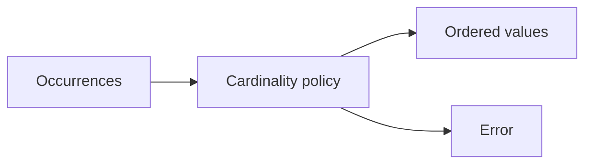

# FEAT-05: Cardinality and Special Forms

## Status
**ACTIVE**

## Capability
Support flags, optional and repeated values, collections and rest positionals
with explicit consumption and duplication semantics.

## Context
Depends on [FEAT-02](FEAT-02-Options-And-Arguments.md),
[FEAT-03](FEAT-03-Token-Grammar.md),
[FEAT-04](FEAT-04-Typed-Conversion.md), and
[FEAT-06](FEAT-06-Defaults-And-Validation.md). Results and diagnostics belong
to [FEAT-07](FEAT-07-Parse-Results-And-Diagnostics.md). Maz examples and alternatives are
in `../maz/specs/CLI Parser Specification.md` and
`../maz/CliGenerator.Tests/CliParserBehaviorTests.cs`.

## Requirements
### FEAT-05-001 - Boolean forms
Boolean options must support a bare flag and explicit true/false values; any negated form must have unambiguous registration and collision handling.
**Acceptance:** `--verbose` yields true and `--verbose=false` yields false; a negation alias collision is rejected rather than routed arbitrarily.
**Security:** A malformed boolean must not become true by fallback.

### FEAT-05-002 - Optional values
An option declared with an optional value must distinguish a bare occurrence from an explicit value and define how following tokens are consumed.
**Acceptance:** `--filter=x` supplies `x`, while `--filter child` leaves `child` for command/positional interpretation; bare and absent remain distinguishable.
**Security:** Do not consume a potential command or filename as an optional value without the approved rule.

### FEAT-05-003 - Repetition and collections
Define scalar repetition, collection accumulation and per-occurrence value boundaries deterministically.
**Acceptance:** Repeated `--tag=a --tag=b` accumulates in order; repeated scalar `--count=1 --count=2` is an error; zero values on a required collection occurrence fails.
**Security:** Bound resource consumption and reject malformed repeated input rather than silently overriding security-sensitive options.

### FEAT-05-004 - Rest positionals and short clusters
A rest positional consumes the remaining positional values in order and must be last; combined short forms are expanded atomically only when every member consumes no value.
**Acceptance:** `a -- -b c` binds `a`, `-b`, `c` to a sole rest positional; a rest followed by another positional is rejected; valid zero-value `-vaf` expands to the same occurrences as `-v -a -f`; a value-taking or unknown member rejects the whole cluster.
**Security:** Reject unknown or value-taking clusters rather than partially executing an unintended combination of options.

## Design
#### Arity modes

| Mode | Token consumption | Value / occurrence semantics |
| --- | --- | --- |
| Boolean flag | Bare means true; consume the following token only if it is exactly true/false ignoring case; equals also works. | Absent false is a declared convenience default, not explicit presence. |
| Explicit negating boolean alias | Zero value tokens; assigns false. | Must be declared with negating meaning. A `--no-` spelling alone has no magic. Equals is rejected; a following token remains unconsumed. |
| Required scalar value | One inline or following value. | Missing value is an error; FEAT-03 defines dash/marker boundaries. |
| Optional scalar value | Zero tokens unless an inline equals value is present. | Bare requires a declared bare value/factory or nullable-null policy; no implicit `default(T)` rescue. |
| Repeated single-value collection | Exactly one value per occurrence. | Append successfully converted elements in argv order. |
| Multi-value collection | Inline equals supplies one value only; space syntax greedily consumes one or more values. | Stop before any option-like token or `--`, except numeric negative candidates per FEAT-03; repeated occurrences append atomically in argv order. |

Every definition selects one compatible mode. Boolean flag/negating aliases
and optional-value mode are scalar; nullable inference does not imply counting.
Counting is an explicit mode selected with `Arity = Counting`. It supports only
`int` (absent value 0) and `int?` (absent value null). Each exact long/short
occurrence and each matching character in a cluster increments the count.
Negating aliases target the same boolean identity, so a
positive plus negated occurrence counts as repetition of one scalar.
Reject all repeated non-counting scalars, even repeated equal values. This
avoids declaration-order/last-wins surprises. Boolean collections use explicit
true/false element values, not bare flag semantics.
Flag literals are intrinsically true/false, never application-converted.
All inline flag text is checked without user callbacks once structural
checks succeed; the help flag alone is checked early to resolve the
FEAT-08 bypass. An ordinary invalid flag literal blocks normal validation
but is bypassed by an otherwise valid true help request, just like other
ordinary value failures.

Short clusters contain only zero-token forms (`BooleanFlag`, `Counting`, and
bare `OptionalScalar` with an explicit bare policy). Preflight the entire
cluster before recording any occurrence. A value-taking member, unknown
character, or negating alias invalidates the entire original token. Repeated
boolean/optional definitions still produce duplicate-scalar errors. No
short spelling implies counting semantics.
Generated declarations infer BooleanFlag for nonnullable `bool`,
GreedyCollection for supported `IReadOnlyList<T>` option properties, and
RequiredScalar for other option properties. A named arity override may select
another compatible mode; inference does not weaken the same runtime
validation used by explicit definitions.
Boolean space syntax intentionally wins over a literal child/path named
true/false; this ambiguity is an explicit approval item, not hidden greed.
For literal paths use `--`, and for a following child named true/false use
an inline boolean value before that child.

#### Greed, conversion and rest

Greedy collections do not reserve future child command names: those names
are values while an occurrence is consuming. Use repeated equals forms
before a subcommand, or place a greedy collection on a leaf, to remove that
ambiguity. Do not silently roll tokens back after a failed conversion.
Stage each occurrence's converted elements separately and commit none if
an element is invalid. The whole parse is unsuccessful even if earlier
occurrences converted successfully; typed success access is gated by FEAT-07.

An empty collection is a per-parse value when no occurrence is supplied
and the definition declares the standard empty factory. An occurrence with
zero elements is a missing-value error, not that empty default. `--tag=`
is one empty string element; for numeric elements it is a conversion failure.
Do not split comma-containing tokens.

A final rest positional consumes the remaining positional sequence, not
the raw remainder of argv: recognized options are still removed before `--`.
After `--`, all tokens including option names are positional. Rest elements
use FEAT-04 conversion and declared minimum arity; a required rest needs at
least one element. Resource limits come from FEAT-07, not unbounded allocation.

A zero-minimum rest always normalizes to a fresh empty-sequence factory when
no positional tokens occur; custom absent defaults for rest are not initial
scope. An optional ordinary collection option without a declared default
remains unavailable when absent, as in FEAT-06. Collection helpers explicitly
install an empty factory. An optional scalar before a required rest is an
invalid definition; before a zero-min rest it greedily takes the first
positional, and the rest receives the remainder.

#### Acceptance matrix

Fixture: inherited `--verbose` boolean/`-v`, explicitly negating
`--no-verbose`, optional nullable string `--filter`, scalar `--count`,
multi-value string `--tag` and numeric `--number`; child `copy` has rest paths.

| argv | Expected outcome |
| --- | --- |
| `["--verbose","false","copy"]` | Verbose explicitly false; select copy. |
| `["--verbose=maybe"]` | Invalid boolean; never true by fallback. |
| `["--no-verbose=true"]` | Unexpected value on a zero-arity negating alias. |
| `["--verbose","--no-verbose"]` | Duplicate scalar error, not a final false value. |
| `["--filter","copy"]` | Bare filter with null; select copy. |
| `["--filter=","copy"]` | Explicit empty filter string; select copy. |
| `["--tag=a","--tag=b","copy"]` | Tags `[a,b]`; select copy. |
| `["--tag","a","copy"]` | Tags `[a,copy]`; root stays selected because both were values. |
| `["--tag","--verbose"]` | Missing tag value; verbose is still processed separately. |
| `["--number","-1","-2","--"]` | Numeric collection `[-1,-2]`; marker remains a boundary. |
| `["copy","a","--verbose","--","-b"]` | Paths `[a,-b]` plus verbose; no option parsing after marker. |
| `["-vv"]` with a counting `v` option | Count 2. |
| `["--count=1","--count=2"]` for an ordinary integer scalar | Duplicate scalar error. |
| `["--tag","a","b","--tag","c"]` | Ordered collection `[a,b,c]`. |
| `["--tag","-1"]` | Missing tag value plus UnknownOption; string elements have no numeric dash exception. |
| `["copy"]` with zero-min rest | Available empty sequence from its normalized factory. |
| Optional scalar followed by one-min rest | Invalid model, not an argv allocation guess. |

#### Source extraction and approval

Maz supports automatic `--no-X`, optional following values, mutable list
accumulation and repeated identical short characters as an integer count.
Those are useful inventory, not hidden requirements here. Explicit negation,
equals-only optional values, duplicate-scalar rejection, atomic collection
conversion and opt-in count stacking are accepted choices recorded here.
This table is the full initial grammar; maz need not be inspected.

## Metrics Impact
**Instruments:** none - cardinality adds no runtime instrumentation.

## Verification
Portable behavior tests are declared in
[`CliParserTests`](../../tests/Mauve.Cli.Tests/Parsing/CliParserTests.cs)
for boolean forms, optional values, repeated and greedy collections, rest
positionals, atomic short clusters and counting options. No product test-run evidence has
been imported as Governance evidence; local suite results are recorded in the
[validation ledger](../validation-gaps.md).

## Diagrams

