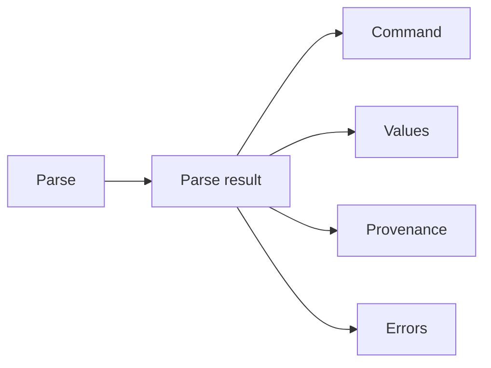

# FEAT-07: Parse Results and Diagnostics

## Status
**ACTIVE**

## Capability
Return an inspectable parse outcome with command selection, typed values,
provenance and safe structured errors.

## Context
Depends on [FEAT-01](FEAT-01-Command-Model.md),
[FEAT-02](FEAT-02-Options-And-Arguments.md),
[FEAT-03](FEAT-03-Token-Grammar.md),
[FEAT-04](FEAT-04-Typed-Conversion.md),
[FEAT-05](FEAT-05-Cardinality-And-Special-Forms.md) and
[FEAT-06](FEAT-06-Defaults-And-Validation.md). The bounded ordering and
suggestion policy is recorded in
[ADR-006](../Architecture/ADR-006-Results-Limits-And-Suggestions.md). Evidence:
`../maz/Console/Cli/Parsing/CliParser.cs` and
`../maz/CliGenerator.Tests/CliParserBehaviorTests.cs`.

## Requirements
### FEAT-07-001 - Result and provenance
Return the selected canonical command/path and typed values with explicit, defaulted or absent provenance, without mutable state shared across parses.
**Acceptance:** A supplied zero and defaulted zero have equal values but distinct provenance; two concurrent parses of the same model retain independent results.
**Security:** Expose values only through caller-controlled result access; do not log them automatically.

### FEAT-07-002 - Structured errors
Return deterministic structured categories and relevant definition/token-position context for malformed definitions, missing values, conversion and validation errors.
**Acceptance:** An invalid integer and a missing value are distinguishable, with stable locations across identical runs; formatted missing-input diagnostics name visible required options or arguments. Parse-time unsupported definitions and oversized input have structured failures, and positive configured model limits reject oversized graphs.
**Security:** Base messages and formatting with `includeArgumentText: false` do not include raw input. Never render callback exception text.

### FEAT-07-003 - Unmatched input
Expose unmatched tokens as failures by default and define any explicit permissive mode without treating unmatched input as recognized.
**Acceptance:** Unknown `--wat` and excess positional input fail by default; unmatched tokens remain explicitly inspectable on invalid results and never make a parse dispatchable.
**Security:** Never silently discard unknown input. Default display quotes only unexpected positional input, with escaping and a length bound. Hosts must suppress argument text when output may contain secrets or be logged.

### FEAT-07-004 - Bounded suggestions
Where suggestions are offered, derive them from visible declared names and limit candidate count and work.
**Acceptance:** A typo near a visible command or option can yield up to five bounded canonical suggestions; hidden names, overlong input and no close match yield none.
**Security:** Do not suggest hidden names by default or include sensitive values; bound work for large input.

## Design
#### Result schema

`ParseResult` records the immutable model snapshot identity through its
definition handles and outcome kind (`Validated`, `HelpRequested`,
`HelpTreeRequested` or `Invalid`), canonical selected command/path, ordered diagnostics and unmatched
occurrences. Its `Arguments` property exposes a defensive copy through
deliberate caller access; mutable input arrays are not result storage and
input is never automatically logged. Input-limit and unsupported-model
failures have no selected path. An empty argv against a valid model selects
the root.

Each value entry identifies its owner/definition, presence (`Absent`, `Bare`,
`WithValue`), origin (`Absent`, `Default`, `Environment`, `Explicit`), availability/invalid
state and the supplying token indices. Typed value access must distinguish
unavailable from available null/default(T). Definition lookup is by validated
identity/handle, not a global alias dictionary. Reject a handle from another
model. Ordinary typed value retrieval requires a Validated outcome; other
results permit inspection of diagnostics/coordinates, not dispatchable
partially validated objects.
Validated permits unavailable optional entries without defaults, but never
invalid entries. Presence-aware Try access reports unavailable; a direct
getter for an unavailable entry throws a fixed InvalidOperationException
without raw input. HelpRequested and HelpTreeRequested have no typed value entries.

Collections exposed as successful results have read-only containers and
parse-local storage. The library does not deep-freeze arbitrary custom
reference values; custom converter/default factory ownership requirements
are explicit in FEAT-04/06. No previous result is mutated by the next parse.

#### Diagnostics, locations and ordering

Stable codes are the public `ParseDiagnosticCode` enum values:

| Category | Meaning / location |
| --- | --- |
| InvalidModel | Unsupported model definition or converter; definition identity, no invented argv index. Invalid command graphs fail during `CommandModel.Create`. |
| UnknownCommand / UnknownOption / UnexpectedArgument | Unrecognized occurrence at its original token index. |
| OptionOutOfScope | Ancestor-local option consumed before descending, but invisible on the final command; original option index. |
| MissingValue / UnexpectedValue | Known option arity violation; option token index. |
| DuplicateOption | A repeated scalar; repeated occurrence plus first-occurrence reference. |
| ConflictingOptions | Mutually exclusive built-in help modes; no invented token index. |
| InvalidValue | Conversion failure; supplied value's index, owning option index when separate, and optional inline offset. |
| MissingRequired | Required option/argument absent; definition identity without a fabricated token index. |
| InputLimitExceeded / DiagnosticLimitExceeded | Explicit bound exceeded; do not silently truncate into success. |

`ValidationFailed` is defined by active FEAT-06; this feature specifies
additional result coordinates and deterministic ordering for diagnostics.
Coordinates are zero-based argv indices, excluding the executable/root name.
Environment-origin values have no argv coordinates and do not synthesize
tokens; their source and precedence are owned by
[FEAT-16](FEAT-16-Environment-Option-Binding.md).
For `--count=x`, both option/value index are that token and the value offset
is the UTF-16 code-unit index after its first `=`. Defaults have no token coordinates.
Descriptions/messages contain safe declared names and bounded reason text,
not raw values, exception messages or `ToString()` of application objects.
`ParseDiagnostic.ToString()` adds a one-based argument position when known
(preferring the value token for value errors), and appends any bounded
visible suggestions. Missing required input names the visible selected command
and declared option or argument without inventing a position.
`ParseDiagnostic.ToString()` and `ParseResult.FormatDiagnostics()` both quote
escaped unexpected positional text by default, using at most 128 UTF-16 code
units of the token before escaping. Pass `includeArgumentText: false` to
either formatter to omit it; the unmodified token remains inspectable on the
result. Unknown command and option text is not echoed.
Callback validation failures supply a bounded reason identifier (at most
64 ASCII letters/digits/dot/underscore/hyphen) and may supply an explicit
public message. The default formatter appends the single-line, sanitized,
512-code-unit message to the category template, except for sensitive or
hidden targets. Item failures prefix the reason with a one-based item number.
Authors own the safety of public message content: never include secrets or
raw input. Exception text and reason identifiers are not implicitly rendered.
Malformed/oversized callback reason identifiers are callback contract faults,
not truncated or rendered strings; throw a fixed InvalidOperationException
without including their content.
Hidden definition names are replaced by a generic label in default display;
their canonical identities remain available to explicit caller inspection.

Order model errors by deterministic definition traversal. Diagnostic phases
are: structural scan/scope/duplicate errors by token index; conversion
InvalidValue errors by supplying-token index; MissingRequired in effective
definition order; per-value ValidationFailed in definition/registration
order; cross-value ValidationFailed in registration order. Use ordinal
category name as a same-index tiebreaker. FEAT-06's stage gates still apply:
structural errors suppress conversion; missing-required/conversion errors
suppress defaults/value validators, not an interleaved validation stage.
One missing value plus an unknown
following option may produce two diagnostics. An invalid supplied value
does not additionally become MissingRequired: occurrence and validity differ.
Unexpected callback exceptions propagate as application faults, rather than
being mislabeled as user-input errors or successful defaults.
`CliValidationException` is the explicit expected-rejection exception and is
translated to a structured validation failure under
[ADR-017](../Architecture/ADR-017-Declarative-Validation.md).

#### Bounds and unmatched behavior

`CliLimits` configures positive upper bounds on a `CommandModel`; defaults are
4096 argv tokens, 16384 UTF-16 code units per token, 1048576 total code units,
64 command nesting levels, 4096 local options on one command, 10000 command/
option/argument nodes, and 64 diagnostics. Limits are not performance claims.
Model depth, option-count and node-count violations reject model creation
before snapshot arrays are allocated. Parsing returns Invalid with
InputLimitExceeded when an argv limit is reached. If another ordinary diagnostic would exceed the configured capacity, replace
the final slot with DiagnosticLimitExceeded (at most 63 ordinary diagnostics
plus the marker under the default).
Null argv is an API argument error before parsing. Check count before
enumerating elements; an over-count vector returns Invalid/InputLimitExceeded
at the first excess index (4096 by default) without reading it. Otherwise
inspect tokens left-to-right: an encountered null element is an API argument
error; an overlong token or aggregate-size violation stops at that offending
index. Input-limit outcomes have no selected path and run no routing/callbacks.
Check model depth before descent. Model graph violations are rejected by
`CommandModel.Create`; they do not produce a parse path or invoke application
callbacks.

Strict parsing fails on all unmatched occurrences. Strict mode is the initial
required surface; no permissive forwarding mode is approved. A future inspection-only
mode may retain them for tooling, but must remain ineligible for invocation;
this is not pass-through command execution. Do not implement shell execution
or forwarding simply because an unmatched list exists.

Suggestions are advisory only: inspect at most the first 256 visible
canonical names/aliases in declaration order, compare at most 128 characters
per name/input, use ordinal comparison and bounded edit distance at most two,
and return at most five unique canonical candidates. Prefix matches are
eligible even when full edit distance exceeds two. Rank prefix matches,
then distance, then canonical ordinal name. Do not inspect hidden names or
emit suggestions when the input-length bound is exceeded. A suggestion never
changes selection or success.
UnknownCommand pools only the current command's children; UnknownOption
pools the current effective option names/aliases. No suggestions are emitted
for out-of-scope options, conversion/positional errors or arbitrary values.
Attach canonical candidate identities/spellings in a structured Suggestions
field, not interpolated typo text. All limits apply before matching/dedup.

#### Test fixtures and extraction

Assert categories/coordinates/provenance independently of localized wording.
Cases include explicit/default zero, available-null versus missing,
`["--count=x"]` offset, value/command text repetition, unknown secret-like
tokens absent from formatted messages, deterministic cap overflow, cross-model
handles, and parsing the same model concurrently with different inputs.

Maz returns mutable string errors/unmatched text and stores values on option
instances. Those details are deliberately replaced by structured safe
outcomes and per-parse storage. Its fuzzy suggestions are not an execution
fallback.

## Metrics Impact
**Instruments:** none - results introduce no runtime metrics.
**Diagnostics:** `InputLimitExceeded`, `DiagnosticLimitExceeded`

## Verification
Portable behavior tests are declared for provenance, independent and
concurrent parses, categories and coordinates, input/diagnostic bounds,
unmatched input, model limits and hidden/bounded suggestions. No product
test-run evidence has been recorded yet; see the [validation ledger](../validation-gaps.md).

## Diagrams

