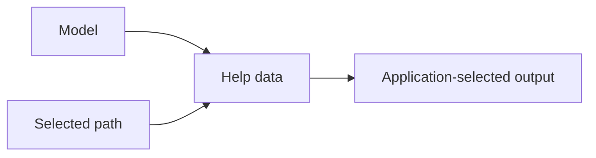

# FEAT-08: Help and Usage

## Status
**ACTIVE**

## Capability
Produce useful, customizable help from command and argument metadata.

## Context
Depends on [FEAT-01](FEAT-01-Command-Model.md),
[FEAT-02](FEAT-02-Options-And-Arguments.md),
[FEAT-06](FEAT-06-Defaults-And-Validation.md), and
[FEAT-07](FEAT-07-Parse-Results-And-Diagnostics.md), and
[FEAT-15](FEAT-15-Directives.md). Pack grouping is
provided by [FEAT-14](FEAT-14-OptionPacks.md); its composition rules
are not owned here. The implementation decision is recorded in
[ADR-007](../Architecture/ADR-007-Help-Projection-And-Precedence.md).
Reference: `../maz/Console/Cli/CommandDef.cs` and
`../maz/Console/Cli/OptionPack.cs`.

## Requirements
### FEAT-08-001 - Usage metadata
Render root and selected leaf usage from the model, including names, aliases, arguments and requiredness. Format option spellings from prefix-free long/short metadata using the active syntax configuration.
**Acceptance:** Root help lists visible children; leaf help identifies positional order and option aliases; usage starts with the supplied executable name, and repeatable options are identified. An empty command still has valid usage.
**Security:** Render metadata as inert text and never invoke handlers to produce help.

### FEAT-08-002 - Visibility and defaults
Honor hidden metadata and display declared default information only when safe and explicitly permitted.
**Acceptance:** A hidden option is absent from ordinary help; an explicitly displayable non-sensitive default appears, while a sensitive default does not.
**Security:** Never evaluate a default factory merely to render help or reveal secret values.

### FEAT-08-003 - Grouping and customization
Support application-supplied output customization and pack group metadata without changing parse semantics.
**Acceptance:** Two pack groups render separately in stable order with their title followed by `options`; standard help options form their own section, and directives are last. A custom output sink receives the same model-derived information.
**Security:** No terminal control sequences from untrusted metadata may be emitted unsafely by default.

### FEAT-08-004 - Help precedence
Specify whether help bypasses requiredness and validation and how it interacts with malformed or unknown input.
**Acceptance:** Leaf help works without required inputs, but malformed definitions and unknown options still produce failure; no handler executes.
**Security:** Help must not mask malformed models or transform a failed parse into an invocation.

### FEAT-08-005 - Command invocation examples
Expose ordered immutable command examples through the explicit builder and generated models, and project sanitized full invocation examples into help.
**Acceptance:** A child `add --text AAA` under `todo item add` becomes `todo item add --text AAA`; full paths and alias/nonmatching prefixes stay unchanged. Standalone `$0` denotes only the executable, with a configurable host value and deterministic root-label fallback for direct projection. Default and custom renderers receive identical expanded, sanitized examples. Invalid empty or multiline builder examples are rejected.
**Security:** Examples are inert text, never parsed or executed. Sanitize all example and executable display text before exposing it, and do not change canonical routing identities or invoke application callbacks.

### FEAT-08-006 - Command tree help
When standard help is enabled, expose `--help-tree` on every command and render a sanitized, ordered Unicode tree.
**Acceptance:** Root help shows all visible descendants; selected-command help shows the root, an omission marker, and the selected subtree. True `--help` and `--help-tree` together produce `ConflictingOptions`; malformed input takes precedence.
**Security:** Exclude hidden subtrees, sanitize all projected text, and never invoke command handlers, converters, default factories or validators to render the tree.

## Design
#### Command tree help

`--help-tree` is installed with standard help and follows its intrinsic
Boolean parsing, structural-error precedence, callback bypass, directive
ordering, and collision rules. False does not request help. When both help
options are true the parse is invalid with `ConflictingOptions`. A distinct
`HelpTreeRequested` parse and invocation outcome carries no typed values.

The tree projection contains only sanitized names and single-line short
descriptions, never hidden commands or their descendants. Root selection
includes the entire visible hierarchy. For a selected descendant, show the
root, `... other commands omitted...`, and the selected command as sibling
children of the root, followed by its visible descendants. A hidden command
or a descendant of a hidden command is not eligible for tree projection.
Render names as `name (description)` when a description is present and `name`
otherwise. Use `├── `, `└── `, `│   ` and four spaces for connectors and
LF between lines. Custom renderers receive the same sanitized projection.

#### Command examples

`CommandBuilder.AddExample` accepts one nonempty invocation line; the immutable
`CommandDefinition.Examples` snapshot preserves declaration order.
`HelpDocument.Create(model, command, executableName)` exposes expanded,
sanitized `Examples`. Default rendering places `Examples:` after descriptions
and before the other sections. Preserve internal spaces and quotation marks;
long example lines are visually wrapped to the configured width without
interpreting shell syntax.

An example starting with the selected child's canonical name gains its missing
canonical ancestors, including the declared root display label. An already
full canonical path stays unchanged. Alias-led and nonmatching examples remain
as authored; this is not shell parsing or partial-path guessing.

A standalone `$0` (bounded by whitespace or line boundaries) substitutes the
executable display value, never a declared application command. For example,
`$0 item add --text AAA` uses the binary plus its authored application path;
`$0 add --text AAA` on the nested add command becomes
`<binary> item add --text AAA`. Quoted `"$0"`, `x$0`, and `$00` stay literal.
The direct projection defaults the executable value to the root display label;
`CliHostOptions.ExecutableName` defaults to `Environment.GetCommandLineArgs()[0]`
and is supplied by both high-level entry points. Parser and `Main(string[] args)`
tokens still exclude the executable. Substitution is display-only and does
not perform platform-dependent shell quoting. In examples only, executable
names longer than 30 characters are displayed as `.../` plus the final path
component, recognizing both slash styles.

#### Help model and rendering

Separate a pure `HelpDocument` data projection from text rendering. Input is
a validated immutable model and an optional command definition from that
model.
Data includes executable-based usage and the canonical selected child path, descriptions, visible child summaries,
ordered positionals, visible local/inherited options with aliases and
value labels, safe declared default/allowed-value text, and stable pack
group identities/titles/descriptions. Do not construct command/pack instances
or invoke handlers, converters, default factories, validators or providers.

Plain-text ordering: usage; short/long description; examples; visible children
in declaration order; positionals; option groups ordered by their first
member's appearance in FEAT-12's effective definition order. Ungrouped options
belong to an owner-specific ungrouped group, not one global group moved before
all packs. Preserve effective order within each group. Grouping may move
separated members together; effective order is presentation input, not a
strict global rendered sequence. A scalar required positional is `<source>`, optional is
`[destination]`, rest is `<paths...>` or `[paths...]` according to minimum.
Options display aliases together, with `<value>` for required arity and
`[=<value>]` for optional-value syntax. State that optional values require
equals; do not imply a space form the parser rejects. Required-presence
options are marked explicitly, regardless of default display. Repeatable
collection and counting options are marked as repeatable. Built-in help
options form a separate group; directives render after all option groups.
Sections are separated by a blank line. Short and long descriptions are each
indented two spaces and separated by a blank line; option pack titles end in
`options` and align with other section headings, and all option entries use
two spaces. A pack description is separated from its options by a blank line;
a pack with no visible options has no rendered section.

Group identity is its declaring owner/inclusion path and stable group key,
not title text. FEAT-14 owns
membership and inner-versus-outer precedence. Never duplicate an inherited
option in a descendant's help. `Hidden` suppresses discoverability, not
parsing; default values marked sensitive remain suppressed in all display
modes, including explicitly supplied display-only default/allowed-value
strings and sensitive positional metadata. A display permission never
overrides sensitivity. An inert default on a required definition is not
displayed as effective (FEAT-06). Advanced-only help remains out of scope.

Text output is deterministic and independent of ambient terminal width.
Default width is 80 columns, configurable explicitly, and values below 20
columns are rejected. Output uses LF line endings and wraps long unbroken
words as well as ordinary text.
Sanitize every display field before constructing the public projection:
remove C0/C1/DEL control characters (including ESC/CSI/NEL), Unicode line/
paragraph separators and bidi control characters. Titles/labels become
single-line; normalize description CRLF/CR to LF and preserve LF only as
plain paragraph boundaries, removing other controls. Renderers wrap plain
text explicitly and never interpret embedded ANSI/Markdown. A custom
renderer receives already sanitized/sensitivity-filtered data, not a raw
metadata escape hatch. Fail a throwing output sink explicitly;
do not report successful display after a write fault.

The public surface is `HelpDocument.Create(model, command)`,
`HelpTextRenderer.Render(document, width)` and `HelpOutput.Write`. The
projection excludes hidden definitions and includes explicit default text
only for non-required, non-sensitive definitions with an active default
policy. Option groups expose the selected command's canonical path separately
from their stable group key; ungrouped options use the owner-specific
`@ungrouped` key, which cannot collide with a declared group key.
Reusing a key with conflicting title or description metadata on one command
is an invalid model.

#### Help request and error precedence

Rendering an explicitly selected command's help is separate from recognizing
a help option in argv. `CommandModel.Create(..., includeStandardHelp: true)`
installs marked boolean `--help`/`-h` and `--help-tree` definitions on every command in the
snapshot; this provides selected-leaf recognition until FEAT-12 implements
general option inheritance. Reject spelling collisions instead of silently
overriding application flags. The token must set help
true; `--help=false` or `--help false` is an ordinary false flag value, not a help request.
`--help` after `--` is a positional. No automatic help subcommand is implied.

Scan and resolve the complete argv with ordinary grammar/arity first.
Resolve this helper's true/false literals intrinsically, case-insensitively,
without an application converter: `--help=maybe` is InvalidValue, repeated
help is DuplicateOption, and negating/value syntax obeys FEAT-05. Its boolean
literal check is the sole built-in value check needed before help bypass;
it never invokes user callbacks and cannot be overridden by their converters.
If there is a true help occurrence and no structural input/model errors,
return a distinct `HelpRequested` outcome for the selected command, bypassing
all conversion, requiredness/defaults and application validators.
It is error-free help, not a validated result eligible for invocation.
Malformed model, unknown option/command, excess positional, missing option
value, duplicate scalar and out-of-scope options still fail; help never
repairs their token structure. Invalid conversion text is not converted on
the help path and therefore does not prevent help.

| argv / condition | Outcome |
| --- | --- |
| `copy --help`, required source omitted | Leaf help; no requiredness error or callbacks. |
| `copy --count=bad --help` | Leaf help; numeric converter is not called. |
| `copy --count --help` | MissingValue for count; no successful help outcome. |
| `copy --wat --help` | UnknownOption; do not hide the typo. |
| `unknown --help`, root has children and no positionals | UnknownCommand; no successful root help. With a declared positional the word can bind intentionally (FEAT-01). |
| `copy --help=maybe` / `copy -h --help` | InvalidValue / DuplicateOption, never HelpRequested. |
| `copy --help FALSE` | Normal parse with help false; ordinary missing-required checks still apply. |
| `copy -- --help` with a rest path | Literal path; normal requiredness/conversion applies. |
| Explicit safe default text but a throwing default factory | Help may display that static text without calling the factory. |
| Hidden or sensitive option in extended custom output | Hidden excluded; sensitive actual and display-only default/allowed-value text never supplied. |
| Retry child pack flattened before Network own options | Retry group precedes Network; inherited ungrouped root options do not jump ahead of local groups. |

#### Extraction and implementation boundary

Maz predefines several help options and groups pack options in a renderer
that also serves its application UI. Only metadata-derived usage/grouping
is carried forward; renderer/config/environment services are excluded.
The helper installation, layout, width policy and bypass precedence above
are the approved behavior. Pack membership/order and general inherited
options remain owned by FEAT-14 and FEAT-12 respectively; inspecting maz is
unnecessary.

## Metrics Impact
**Instruments:** none - help does not introduce runtime metrics.

**Diagnostics:** `ConflictingOptions`

## Verification
`HelpTreeTests.Render_ProjectsVisibleFullAndSelectedTreesSafely`,
`HelpTreeTests.Write_UsesSanitizedProjectionAndPropagatesOutputFaults`,
`CommandModelTests.Create_InstallsHelpTreeAndAccountsForItsLimitsAndCollisions`,
`CliParserTests.Parse_HelpTreeHonorsHelpPrecedenceAndConflicts`, and
`CliInvokerTests.Run_HelpTreeUsesHostOutputAndPreservesDirectiveOrder` cover
FEAT-08-006. `scripts/verify-aot.sh` also runs root and selected help trees
on generated and explicit trimmed and NativeAOT examples. Actual results are
recorded in the validation ledger.

`HelpDocumentTests.Create_ExpandsCanonicalExamplesWithoutReplacingDeclaredCommandNames`,
`Create_SnapshotsExamplesAndRejectsInvalidExampleInputs`, and
`Create_AbbreviatesLongExecutableOnlyInExampleSubstitutions`, and
`CliInvokerTests.Run_PassesExecutableExamplesToDefaultHelpRenderer`, and
`RunAsync_PassesExecutableExamplesToCustomHelpRenderer`
verify FEAT-08-005. Observed results belong in the validation ledger.

`HelpDocumentTests.Create_ProjectsVisibleCommandsPositionalsAndOptionAliases`,
`HelpDocumentTests.Create_SanitizesMetadataAndSuppressesHiddenOrSensitiveDefaults`,
`HelpDocumentTests.Write_PreservesGroupOrderAndUsesCustomRendererAndSink`,
`HelpDocumentTests.Render_SeparatesAndIndentsOptionsAndPlacesDirectivesLast`,
`CliParserTests.Parse_HelpBypassesConversionAndRequirednessButNotStructuralErrors`
and `CommandModelTests.Create_RejectsStandardHelpOptionCollisions` cover the
projection, output and precedence contracts. The package-free harness invoked
these methods successfully, but it is not product MSTest or Governance
acceptance evidence; the product test run remains blocked by the missing
local Governance feed. See the [validation ledger](../validation-gaps.md).

## Diagrams

