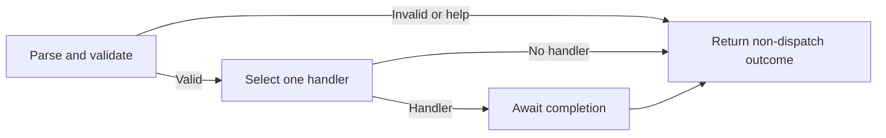

# FEAT-09: Invocation Lifecycle

## Status
**ACTIVE**

## Capability
Invoke a selected handler with validated inputs, cancellation and explicit
exit/exception responsibilities.

## Context
Depends on [FEAT-06](FEAT-06-Defaults-And-Validation.md),
[FEAT-07](FEAT-07-Parse-Results-And-Diagnostics.md),
[FEAT-08](FEAT-08-Help-And-Usage.md), and
[FEAT-15](FEAT-15-Directives.md). The implementation decision is recorded
in [ADR-008](../Architecture/ADR-008-Invocation-Lifecycle.md).
Application-specific confirmation remains outside the reusable CLI library.
High-level hosts optionally map exceptions and delegate their presentation to
a replaceable renderer; low-level invocation remains transparent.

## Requirements
### FEAT-09-001 - Validated dispatch
Invoke only the selected command handler and only after a successful parse and validation.
**Acceptance:** A valid leaf invokes its handler once with the corresponding values; a missing required input or unknown token invokes none.
**Security:** Never execute a fallback handler on malformed input or validation failure.

### FEAT-09-002 - Synchronous and asynchronous handlers
Support synchronous and asynchronous handlers with equivalent input and outcome semantics.
**Acceptance:** Equivalent sync and async handlers receive the same values and yield the same application-provided exit code; a command with no handler is handled by a defined non-invocation outcome.
**Security:** No fire-and-forget handler may outlive a reported successful invocation.

### FEAT-09-003 - Cancellation
Pass the caller's cancellation signal to asynchronous handlers and expose cancellation without reporting success.
**Acceptance:** A pre-cancelled invocation does not run parser callbacks or the handler; a cooperating running handler observes cancellation and yields Cancelled.
**Security:** Do not dispatch further library-owned stages after observing cancellation; arbitrary handler side effects cannot be forcibly stopped or rolled back.

### FEAT-09-004 - Host ownership
Return or propagate a documented outcome, including application exit codes and handler exceptions; the reusable core must not terminate the process.
**Acceptance:** A handler returning a nonzero code preserves it; a thrown exception propagates to the host with its identity and without calling process exit.
**Security:** The core does not format or expose exception details; the host owns safe presentation and termination.

### FEAT-09-005 - Generated command host entry points
Provide synchronous and asynchronous high-level host methods for generated command roots, defaulting omitted arguments to the current process arguments and allowing hosts to configure help/diagnostic sinks, help rendering, non-handler exit codes and opt-in environment option binding.
**Acceptance:** `CliInvoker.Run<TCommand>()` executes a wholly synchronous generated root; `CliInvoker.RunAsync<TCommand>()` executes either synchronous or asynchronous generated roots; explicit argument lists override process arguments; help and invalid-input results use configured output and exit policy; host entry points and options-aware `InvokeAsync` share environment-binding behavior when enabled.
**Security:** High-level hosting preserves the shared validated-dispatch path, propagates unmapped handler faults, defaults to sanitized help/parser diagnostics and safe mapped exception messages, and never terminates the process directly. Custom exception renderers own redaction under FEAT-09-007.

### FEAT-09-006 - High-level exception mapping
High-level generated and explicit Run/RunAsync hosts resolve typed immutable exception mappings by most-specific assignable class, falling back to CliExitCodeException and propagating unmatched faults unchanged. Low-level InvokeAsync remains unaffected.
**Acceptance:** Sync and async hosts preserve mapped nonzero exit codes, choose the most-specific class regardless of registration order, and never call further invocation stages after a mapped fault. Duplicate registrations and invalid mapping results fail explicitly.
**Security:** A mapped fault cannot return exit code zero. No assembly scanning, dynamic activation, process termination, automatic inner-exception unwrapping or process-wide registry is used. Caller cancellation retains its existing outcome precedence.

### FEAT-09-007 - Replaceable exception rendering
Render mapped exceptions using a host-configured callback receiving the original exception, safe result and executable display name. The default renders only the explicitly safe mapped message to StandardError.
**Acceptance:** A replacement renderer receives the original exception and mapped result once; empty output suppresses writing, while null output, renderer faults and writer faults propagate without remapping.
**Security:** Raw exception messages, stacks and inner exceptions are not displayed by default. Custom renderers and message factories own redaction and thread safety; rendering contexts contain no command arguments or parsed values.

### FEAT-09-008 - Fluent host configuration
Provide a reusable CliHostOptionsBuilder covering all constructor settings, typed mapping composition and exception rendering; retain the constructor as an equally supported API.
**Acceptance:** Equivalent constructor and builder settings produce equivalent help, diagnostics, conversion, environment binding and exception handling. Each Build creates a fresh snapshot isolated from later builder registrations and settings changes; validation uses the constructor's rules.
**Security:** Immutable snapshots do not own or dispose caller writers or callback state. Duplicate mapping composition fails atomically. Builder configuration is not process-global or thread-safe.

## Design
#### Dispatch contract

`CliInvoker.InvokeAsync` performs a fresh parse for each invocation and
dispatches only a validated selected command. Valid root directives execute
in argv order before ordinary parse outcomes or command handlers, and must
appear before the first child command. A public dispatch-existing-result API
is not provided. Cancellation is checked before parsing, between
parser callbacks and stages, and before handler dispatch. A help request,
invalid input, cancellation or missing handler never runs application
handlers.

An invocation context exposes the selected command and its validated parse
result, with typed option and positional accessors. The explicit model
registers at most one handler per command. Synchronous void handlers return
exit code zero; synchronous integer, `Task`, `Task<int>`, `ValueTask` and
`ValueTask<int>` handlers are normalized to an awaited integer result.
Null asynchronous tasks and duplicate handler registration fail explicitly.
Async void and fire-and-forget handlers are unsupported. FEAT-11 owns
declarative method discovery and lowering.

| Outcome | Meaning and host responsibility |
| --- | --- |
| `Completed` | Includes the exact handler exit code, including nonzero; the host decides process-code policy. |
| `InvalidInput` | Includes safe parse diagnostics; no handler ran. |
| `HelpRequested` | Includes the help parse outcome; the host chooses a renderer and sink. |
| `HelpTreeRequested` | Includes the tree-help parse outcome; the host chooses a sanitized tree renderer and sink. |
| `NoHandler` | The selected command is valid but has no registered handler. |
| `Cancelled` | Distinct from success; the host chooses any process-code mapping. |

Unexpected converter, factory, validator or handler exceptions propagate
with their original identity and stack. An `OperationCanceledException`
becomes `Cancelled` only when caller cancellation is requested; otherwise it
propagates. Normal handler completion wins over cancellation requested after
handler entry, preserving its exit code. Cancellation cannot undo side
effects or forcibly stop a non-cooperative handler.

The reusable core does not install Ctrl+C handlers, dispose caller services,
print exception text, or call `Environment.Exit`. Definitions and
application-owned values are not automatically disposed based on
`IDisposable`.

The static `CliInvoker.Run<TCommand>` and `RunAsync<TCommand>` methods are
host conveniences over `InvokeAsync`. They use supplied argument tokens or
the current process arguments excluding the executable name. Their
`CliHostOptions` configure standard-output/help rendering, standard-error
diagnostics, and exit codes for invalid input, no handler, and cancellation;
completed handler exit codes are preserved and unexpected exceptions
propagate unless explicitly mapped by host policy. They consume option environment values only when explicitly
enabled, as specified by
[FEAT-16](FEAT-16-Environment-Option-Binding.md), and do not install process
signal handlers.

Generated roots expose a fresh `CreateBuilder()` through
`IGeneratedCliCommandBuilder`. The directive-list overloads append the supplied
builders before validating the model and installing standard help. Directive
callbacks receive the invocation's host options, including the same output
writers used for help and diagnostics. The synchronous overload rejects
asynchronous additional directives before invocation; callers must use
`RunAsync` for them. Duplicate directive names remain invalid model errors.
An untyped `null` in the second argument position is ambiguous with the
host-options overload; callers can omit it or use `options: null`.

Exception handling applies around invocation only, not model creation,
argument resolution, help rendering, output writing or the synchronous
completion guard. Explicit mappings take precedence over a
`CliExitCodeException`'s own nonzero code and safe message, including a
deliberately registered `Exception` catch-all. No catch-all is installed by
default. Only the thrown exception is matched; inner exceptions and
aggregates are not automatically unwrapped. Exception classes have a single
inheritance chain, so most-specific assignable class matching is unambiguous.
Mapping and rendering callback faults propagate without recursive handling.
Handled exceptions never become public `Completed` invocation results.

`CliHostOptionsBuilder` exposes output/help settings, outcome exit codes,
executable naming, conversion and syntax, grouped environment binding,
registry composition and typed mappings, and exception rendering. Build
reuses constructor validation; null required references and duplicate/invalid
mapping registrations fail at configuration time. Factory-produced safe
messages are validated when invoked. Mutable numeric culture is copied;
writers and callback closure state remain caller-owned references. The
standard exception constructors use nonzero exit code one, never an implicit
success.

## Metrics Impact
**Instruments:** none - invocation introduces no runtime metrics.

## Verification
`ExceptionHostingTests` covers FEAT-09-006, FEAT-09-007 and FEAT-09-008,
including actual generated roots and explicit command models.
`AotAcceptanceTests.VerifyExceptionHosting` exercises generated and explicit
exception hosting under trimmed and NativeAOT publication.
Observed results for these additions are recorded in the validation ledger;
their source declarations alone do not constitute passing evidence.

`CliInvokerTests.InvokeAsync_DispatchesOnlyTheSelectedValidatedHandler` and
`CliInvokerTests.InvokeAsync_NeverDispatchesInvalidOrHelpResultsAndReportsNoHandler`
cover selected dispatch and non-invocation outcomes.
`CliInvokerTests.InvokeAsync_NormalizesSupportedHandlerReturnShapes` covers
the supported explicit handler forms.
`CliInvokerTests.InvokeAsync_HonorsPreCancellationAndStopsBetweenParserCallbacks`
and
`CliInvokerTests.InvokeAsync_ReportsCooperativeCancellationButPreservesCompletedExitCode`
cover cancellation boundaries and completion precedence.
`CliInvokerTests.InvokeAsync_PropagatesHandlerFaultsAndIsolatesInvocations`
covers exception identity and invocation isolation.
`CliInvokerTests.Run_UsesConfiguredHostOutputAndExitCodes` and
`CliInvokerTests.RunAsync_MapsPreCancellationToConfiguredExitCode` cover host
output and exit policy. The generated default-argument path is also exercised
by launching the published Todo CLI with process arguments in the trimmed
and NativeAOT verification script. All these methods passed in the 111-test
strict MTP suite; the verification gate also completed both example publish
and run checks on Linux x64. `CliInvokerTests.RunAsync_RegistersDirectivesAndUsesInvocationWriters`
and `CliInvokerTests.Run_RejectsAsynchronousOrDuplicateAdditionalDirectives`
also passed in that suite. See the [validation ledger](../validation-gaps.md)
for requirement-level evidence.

## Diagrams

