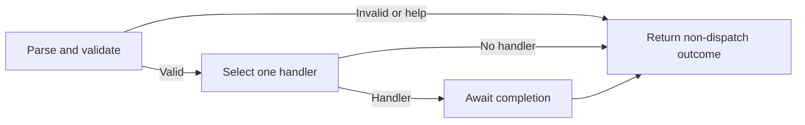

# FEAT-09: Invocation Lifecycle

## Status
**ACTIVE**

## Capability
Invoke a selected handler with validated inputs, cancellation and explicit
exit/exception responsibilities.

## Context
Depends on [FEAT-06](FEAT-06-Defaults-And-Validation.md),
[FEAT-07](FEAT-07-Parse-Results-And-Diagnostics.md), and
[FEAT-08](FEAT-08-Help-And-Usage.md). The implementation decision is recorded
in [ADR-008](../Architecture/ADR-008-Invocation-Lifecycle.md).
Application-specific confirmation and exception formatting are not part of
the reusable CLI library.

## Requirements
### FEAT-09-001 - Validated dispatch
Invoke only the selected command handler and only after a successful parse and validation.
**Acceptance:** A valid leaf invokes its handler once with the corresponding values; a missing required input or unknown token invokes none.
**Security:** Never execute a fallback handler on malformed input or validation failure.

### FEAT-09-002 - Synchronous and asynchronous handlers
Support synchronous and asynchronous handlers with equivalent input and outcome semantics.
**Acceptance:** Equivalent sync and async handlers receive the same values and yield the same application-provided exit code; a command with no handler is handled by a defined non-invocation outcome.
**Security:** No fire-and-forget handler may outlive a reported successful invocation.

### FEAT-09-003 - Cancellation
Pass the caller's cancellation signal to asynchronous handlers and expose cancellation without reporting success.
**Acceptance:** A pre-cancelled invocation does not run parser callbacks or the handler; a cooperating running handler observes cancellation and yields Cancelled.
**Security:** Do not dispatch further library-owned stages after observing cancellation; arbitrary handler side effects cannot be forcibly stopped or rolled back.

### FEAT-09-004 - Host ownership
Return or propagate a documented outcome, including application exit codes and handler exceptions; the reusable core must not terminate the process.
**Acceptance:** A handler returning a nonzero code preserves it; a thrown exception propagates to the host with its identity and without calling process exit.
**Security:** The core does not format or expose exception details; the host owns safe presentation and termination.

### FEAT-09-005 - Generated command host entry points
Provide synchronous and asynchronous high-level host methods for generated command roots, defaulting omitted arguments to the current process arguments and allowing hosts to configure help/diagnostic sinks, help rendering and non-handler exit codes.
**Acceptance:** `CliInvoker.Run<TCommand>()` executes a wholly synchronous generated root; `CliInvoker.RunAsync<TCommand>()` executes either synchronous or asynchronous generated roots; explicit argument lists override process arguments; help and invalid-input results use configured output and exit policy.
**Security:** High-level hosting preserves the shared validated-dispatch path, propagates unexpected handler faults, emits only sanitized help and parser diagnostics, and never terminates the process directly.

## Design
#### Dispatch contract

`CliInvoker.InvokeAsync` performs a fresh parse for each invocation and
dispatches only a validated selected command. A public dispatch-existing-
result API is not provided. Cancellation is checked before parsing, between
parser callbacks and stages, and before handler dispatch. A help request,
invalid input, cancellation or missing handler never runs application
handlers.

An invocation context exposes the selected command and its validated parse
result, with typed option and positional accessors. The explicit model
registers at most one handler per command. Synchronous void handlers return
exit code zero; synchronous integer, `Task`, `Task<int>`, `ValueTask` and
`ValueTask<int>` handlers are normalized to an awaited integer result.
Null asynchronous tasks and duplicate handler registration fail explicitly.
Async void and fire-and-forget handlers are unsupported. FEAT-11 owns
declarative method discovery and lowering.

| Outcome | Meaning and host responsibility |
| --- | --- |
| `Completed` | Includes the exact handler exit code, including nonzero; the host decides process-code policy. |
| `InvalidInput` | Includes safe parse diagnostics; no handler ran. |
| `HelpRequested` | Includes the help parse outcome; the host chooses a renderer and sink. |
| `NoHandler` | The selected command is valid but has no registered handler. |
| `Cancelled` | Distinct from success; the host chooses any process-code mapping. |

Unexpected converter, factory, validator or handler exceptions propagate
with their original identity and stack. An `OperationCanceledException`
becomes `Cancelled` only when caller cancellation is requested; otherwise it
propagates. Normal handler completion wins over cancellation requested after
handler entry, preserving its exit code. Cancellation cannot undo side
effects or forcibly stop a non-cooperative handler.

The reusable core does not install Ctrl+C handlers, dispose caller services,
print exception text, or call `Environment.Exit`. Definitions and
application-owned values are not automatically disposed based on
`IDisposable`.

The static `CliInvoker.Run<TCommand>` and `RunAsync<TCommand>` methods are
host conveniences over `InvokeAsync`. They use supplied argument tokens or
the current process arguments excluding the executable name. Their
`CliHostOptions` configure standard-output/help rendering, standard-error
diagnostics, and exit codes for invalid input, no handler, and cancellation;
completed handler exit codes are preserved and unexpected exceptions
propagate. They do not consume environment variables or install process
signal handlers.

## Metrics Impact
**Instruments:** none - invocation introduces no runtime metrics.

## Verification
`CliInvokerTests.InvokeAsync_DispatchesOnlyTheSelectedValidatedHandler` and
`CliInvokerTests.InvokeAsync_NeverDispatchesInvalidOrHelpResultsAndReportsNoHandler`
cover selected dispatch and non-invocation outcomes.
`CliInvokerTests.InvokeAsync_NormalizesSupportedHandlerReturnShapes` covers
the supported explicit handler forms.
`CliInvokerTests.InvokeAsync_HonorsPreCancellationAndStopsBetweenParserCallbacks`
and
`CliInvokerTests.InvokeAsync_ReportsCooperativeCancellationButPreservesCompletedExitCode`
cover cancellation boundaries and completion precedence.
`CliInvokerTests.InvokeAsync_PropagatesHandlerFaultsAndIsolatesInvocations`
covers exception identity and invocation isolation.
`CliInvokerTests.Run_UsesConfiguredHostOutputAndExitCodes` and
`CliInvokerTests.RunAsync_MapsPreCancellationToConfiguredExitCode` cover host
output and exit policy. The generated default-argument path is also exercised
by launching the published Todo CLI with process arguments in the trimmed
and NativeAOT verification script. All these methods passed in the 90-test
strict MTP suite; the verification gate also completed both example publish
and run checks on Linux x64. See the [validation ledger](../validation-gaps.md)
for requirement-level evidence.

## Diagrams

