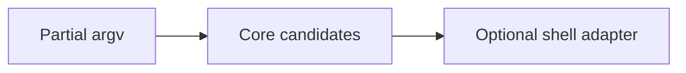

# FEAT-10: Completion

## Status
**ACTIVE** - shell integration supports the bounded syntax described below;
full shell grammar and arbitrary mid-token replacement are not supported.

## Capability
Offer shell-independent command, option and value suggestions with
asynchronous contextual providers.

## Context
Depends on [FEAT-01](FEAT-01-Command-Model.md),
[FEAT-02](FEAT-02-Options-And-Arguments.md),
[FEAT-03](FEAT-03-Token-Grammar.md),
[FEAT-07](FEAT-07-Parse-Results-And-Diagnostics.md) and
[FEAT-08](FEAT-08-Help-And-Usage.md) and
[FEAT-15](FEAT-15-Directives.md). Pack definitions are resolved by
identity through the shared model. Cursor and provider boundaries are recorded
in [ADR-012](../Architecture/ADR-012-Completion-API.md).

## Requirements
### FEAT-10-001 - Contextual candidates
Provide candidates appropriate to the command path, option position and value being completed, using model metadata.
**Acceptance:** A partial child name suggests matching visible children; after a value-taking option its value candidates appear rather than unrelated command names.
**Security:** Hidden items and sensitive prior values must not appear in default candidates.

### FEAT-10-002 - Asynchronous providers
Allow registered asynchronous value providers to receive bounded partial context and cancellation.
**Acceptance:** A provider sees already parsed non-sensitive context and returns values; cancellation reaches an in-flight provider and no successful completion is reported for a cancelled operation.
**Security:** Providers are application-owned; no implicit network or credential access is performed by the core.

### FEAT-10-003 - Failures and bounds
Return a distinguishable provider failure and constrain candidate count and work, rather than converting errors into empty success.
**Acceptance:** A throwing provider produces a failure outcome; a provider exceeding the configured bound cannot produce an unbounded response.
**Security:** Do not expose provider exception messages, secrets or raw untrusted context by default.

### FEAT-10-004 - Shell boundary
Keep core candidates separate from shell-specific quoting and adapter behavior, with an explicit supported-adapter matrix.
**Acceptance:** Core returns a candidate containing spaces as one logical value; the opt-in Bash, Zsh, Fish and PowerShell adapters safely present supported candidates, and an unsupported shell is reported as unsupported.
**Security:** Adapters must not evaluate candidate text as shell code.

### FEAT-10-005 - Shell completion input
Translate a bounded shell completion command-line payload and UTF-16 cursor position to a logical completion request.
**Acceptance:** Executable removal and cursor mapping preserve quoted and escaped arguments and correctly handle an empty active word; invalid coordinates fail explicitly.
**Security:** Treat the payload as inert text, never perform expansion or execution, and respect model input limits.

## Design
#### Completion protocol boundary

The opt-in FEAT-15 completion directive accepts a full command-line payload
including the executable and a UTF-16 cursor position into that payload.
Its adapter decodes whitespace-separated words, single and double quotes,
and backslash escapes outside single quotes; within double quotes, backslash
escapes only double quote or backslash. An unmatched quote is tolerated for
partial completion. The executable is removed and a cursor within it is an
invalid request. A cursor in whitespace after it selects a new empty word;
quoted and escaped characters map to decoded token offsets. Input after the
cursor is retained for replacement but does not select completion context.
The adapter never expands variables, executes commands, or claims support for
shell-specific syntax. A raw cursor outside the payload and oversized inputs
fail explicitly.

#### Shell-independent request

The core receives already-decoded logical tokens, a cursor token index,
UTF-16 character offset within that token, the validated model and cancellation.
Token index may equal token count for an empty token appended at the cursor;
its offset must then be zero. Otherwise require an in-range offset.
Tokens/characters after the cursor do not select a command or bind context.
The host adapter, not the core, handles executable-name removal, shell
lexing/quotes and translating cursor positions from bytes/code points.

Use the prefix before the cursor for filtering. Return a replacement range
covering the whole active token/value segment, including any suffix after
the cursor, so completing `--mode=fa|st` replaces the value, not the option
name or only `fa`. The `|` in examples denotes the cursor, never input text.
For `--name=value`, the value segment begins after the first `=`.
An append position returns a zero-length replacement at a new token.
Determine the active segment before choosing a provider. At/before the first
equals, complete only the option-name segment `[0, equalsIndex)`, preserving
the entire existing `=value` suffix; after equals, replace only the value
segment. This also applies to short equals (`-m=fast`). Unknown or non-valued/
negating aliases after equals produce no value candidates and no provider
call. Null vectors/elements and invalid cursor coordinates are API argument
errors, not successful empty completion.

Candidates carry insertion text (one logical value), sanitized display
text, optional description, kind (command/option/value/positional), definition
identity and replacement coordinates. Results distinguish Completed,
Cancelled, ContextFailed, ProviderFailed and LimitReached. An empty Completed result means
no matches, never a swallowed exception.

#### Context resolution and providers

Walk only completed tokens through FEAT-03's position-aware grammar, tolerating
incomplete required values/positionals. Do not run normal requiredness,
default factories, application validators, command constructors or handlers.
Invalid completed structure yields ContextFailed with FEAT-07 coordinates, not
invocation. The active incomplete token is not itself an unknown-option error.

| Prior syntax state | Active-token completion |
| --- | --- |
| RequiredScalar or RepeatedSingleCollection awaiting its one value | Bare prefixes and valid numeric-negative prefixes target that definition's values. A configured option prefix offers option names instead and records the pending MissingValue, never invents a consumed value. |
| BooleanFlag, no inline value | Offer true/false plus normal command/positional routing for other bare prefixes. Exact true/false route only as boolean values, never a competing child candidate. A configured option prefix offers options. |
| BooleanFlag after equals | Only true/false values; no application converter/provider. |
| Negating alias | No value state; next token resumes normal routing, and equals provides no value candidates. |
| OptionalScalar without equals | Immediately resume normal routing; values complete only inside its equals segment. |
| GreedyCollection after space | Value state persists across bare elements until a configured option-prefix/marker boundary; numeric negatives remain values only for FEAT-03 numeric targets. Other option prefixes offer options. |
| Any ordinary valued mode after equals | Complete exactly its inline value segment; greedy inline equals supplies just one value and does not swallow the following word. |

- While command selection remains open, suggest visible child names/aliases
  matching the prefix. Configured option prefixes suggest currently visible
  prefix-free long names, aliases and short characters. Completed short
  clusters are scanned atomically; counting options are recognized whenever
  their definitions declare counting arity. After the first positional, do
  not offer child-command routing.
- After `--`, never offer commands/options; offer only the active positional's
  values. A rest positional continues to own subsequent positional slots.
- Static value lists and enum names come from declared conversion metadata,
  not `ToString()` over arbitrary objects. Use FEAT-01 name comparison for
  option/command filtering, and the registered value provider's documented
  value comparison policy.

Provider lookup uses definition identity within the selected command path, not
a global alias string. Siblings may both use `--name` with different
providers. Applications explicitly register asynchronous delegates; no
Activator, reflection field walk, global mutable registry or implicit
credential/network lookup is permitted. A provider receives the prefix,
selected path and only successfully converted, prior, non-sensitive values
from its explicit dependency-handle list (empty by default), never arbitrary
values in scope. A dependency must be visible on the selected path; an
unavailable value stays unavailable. Built-in conversions and enum maps are
safe; custom converters must use `RegisterCompletionSafe`, an explicit
completion-safe model registration, or `CliConverter`/definition metadata with
`CompletionSafe = true` before completion will invoke them. Definition-local
overrides participate in the same selection as ordinary parsing. A union is
completion-safe only when every reachable case converter is safe. Model/host
exact-type conflicts fail before callbacks; configuration is operation-local.
See [ADR-015](../Architecture/ADR-015-Converter-Ownership-And-Unions.md).
No absent factory or validator is called to invent context.

Pack lookup uses FEAT-14 inclusion identity and safe data views, not arbitrary
application helper invocation or a first-match search of the root tree.
Hidden/sensitive targets are excluded from all core value suggestions and
provider invocation, including explicitly registered providers;
no raw prior argv or secret strings are automatically logged.

#### Bounds, failures and adapter matrix

Use FEAT-07 input/model bounds; inspect at most 512 returned
candidates, emit at most 128, and accept at most 1024 UTF-16 code units per
candidate. Candidate duplication uses exact ordinal insertion text and
replacement range; retain first occurrence. Preserve declared/provider order
rather than culture-sensitive resorting. Exceeding a bound returns LimitReached
with explicit truncation state, never unmarked complete success.
Count all raw yielded candidates before prefix filtering/dedup, across the
request, so duplicate/nonmatching/infinite sources cannot evade the bound.
Processing order is: inspect/count; validate candidate total insertion/
display/description length (at most 1024 UTF-16 units combined); apply
visibility/privacy and sanitize display per FEAT-08; prefix-filter; dedup;
append up to 128 distinct matches. Oversized candidates yield LimitReached,
not silent skipping. At raw item 512, allow at most one MoveNext lookahead
solely to detect exhaustion; a 513th item or 129th distinct match proves
LimitReached. Never inspect unbounded extra items to prove completeness.
Return any partial candidates explicitly marked incomplete on failure;
they are not a successful complete set or an automatically selected value.

Pass cancellation through awaiting and asynchronous enumeration, dispose
enumerators, and surface provider faults without exception text in default
presentation. Work/count limits constrain core code, not arbitrary callback
CPU or side effects: noncooperative providers cannot be safely killed. Do
not advertise a hard provider time limit without an explicit cooperative
deadline/host-isolation design. No fallback from ProviderFailed to empty
Completed is allowed.
Pre-cancellation runs no providers. On normal/exhaustion/limit paths, dispose
the enumerator and check caller cancellation immediately before finalizing:
requested cancellation yields Cancelled instead of Completed/LimitReached.
Once finalized, later cancellation cannot alter the immutable result.
A provider/enumerator fault yields ProviderFailed even if caller cancellation
arrives later; an OCE with requested caller cancellation yields Cancelled,
while a foreign OCE without caller cancellation is ProviderFailed.
Preserve both enumeration and cleanup faults if both occur, without default
exception-text rendering. Await/dispose fully before reporting an outcome.

| Boundary | Initial proposed support |
| --- | --- |
| Core logical-token completion | Required by this feature. |
| Explicit static/asynchronous providers and typed safe context | Required by this feature. |
| Shell completion payload decoding | Limited quote/escape grammar above; no shell expansion or execution. |
| Bash, Zsh, Fish, PowerShell adapters | Opt-in `[completion:<shell>]` directive generates registration scripts for the bounded syntax below. `CompleteForShellAsync` remains a core-only unsupported placeholder. |
| Raw command-line tokenization / shell execution | Not part of the core API. |

Acceptance fixtures include `fi|`, `file --co|`, `file --mode=fa|st`,
`file --mode |`, `file --filter |` (optional: not a filter value),
`file -- -na|`, a value containing a literal space, sibling provider reuse,
two same-type packs, sensitive dependencies, cancelled enumeration, a provider
throwing after its first result, and a 513-candidate response. A partial failure
must remain a failure even if earlier candidates exist.
Add `--mo|de=fast`, `--mode|=fast`, `--mode=|fast`, `-m|=fast`,
`--unknown=x|`, negating equals, zero providers on hidden/sensitive targets,
513 duplicate/nonmatching results, an oversized display field, provider
dependency leakage, and cancelled-vs-finalized-result race fixtures.

The predefined completion directive uses a versioned private protocol with
inert command-line input and base64-encoded candidates. Shell adapters do not
perform expansion or evaluate candidate text. They accept simple words, quotes,
and backslash escapes subject to the common decoder's grammar; expansions,
shell operators, control characters, and shell-specific escapes are rejected.
Bash, Zsh, and Fish also reject a suffix after the cursor in the active token;
PowerShell supports whole-token replacement. Bash supports an open quote at
the start of a word or immediately after `=`, and unquoted backslash escapes,
but rejects mixed, closed, or backslash-escaped quoted active words. It uses shell-specific escaping and `noquote`
to prevent Readline from introducing executable substitution syntax. Zsh initializes its
completion system if needed; Bash, Zsh and Fish require a `base64` executable.
For Bash, unquoted colons and multiple equals signs in the active word are
rejected because programmable completion may split them into shell fragments.
When `=` is absent from `COMP_WORDBREAKS`, Bash uses whole-token responses and
rejects quoted active words containing `=`.
The adapters do not expose descriptions. These are explicit limitations, not a
claim to implement the full grammar or replacement semantics of any shell.

## Metrics Impact
**Instruments:** none - completion adds no runtime metrics.

## Verification
Focused tests cover command and option candidates, cursor replacement ranges,
inline and pending values, optional/boolean/end-marker behavior, explicit enum
maps, negative numeric values, negating aliases, dependency isolation,
sensitive-target suppression, provider faults, cancellation, candidate bounds
and unsupported shells. `CompletionCommandLineTests` cover raw cursor mapping
and malformed coordinates. These tests passed in the 109-test strict MTP
suite; see the [validation ledger](../validation-gaps.md). The published
examples also produced suggestions in trimmed and NativeAOT execution.
The shell adapter methods and actual shell executions are tracked separately in
the [validation ledger](../validation-gaps.md).

## Diagrams

