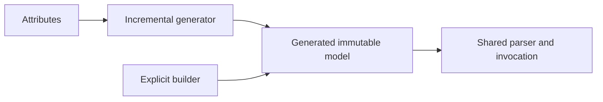

# FEAT-11: Declarative API and Generation

## Status
**ACTIVE**

## Capability
Generate validated command models and typed handler bindings from explicit
declarations, with the same parser behavior available through the builder API.

## Context
Depends on [FEAT-01](FEAT-01-Command-Model.md),
[FEAT-02](FEAT-02-Options-And-Arguments.md),
[FEAT-04](FEAT-04-Typed-Conversion.md),
[FEAT-07](FEAT-07-Parse-Results-And-Diagnostics.md),
[FEAT-09](FEAT-09-Invocation-Lifecycle.md), and
[FEAT-15](FEAT-15-Directives.md). The API and diagnostic decisions
are recorded in [ADR-010](../Architecture/ADR-010-Declarative-Generation.md).

## Requirements
### FEAT-11-001 - Declarative registration
Attributes declare a root, generic child inclusions, options, positional arguments and an optional handler. Names, order and ordinary cardinality are inferred from symbols, source position and property types unless explicitly overridden. The generator emits a `CreateModel` factory and typed binding accessors.
**Acceptance:** A nested declaration with an alias, inferred kebab-case names, typed option and positional argument compiles and invokes its handler; `--arg 1 2 3 --arg 4` binds one ordered collection.
**Security:** Generation uses direct type and method references; it does not scan assemblies or evaluate declaration text.

### FEAT-11-002 - Incremental generation
Use Roslyn incremental generation with stable hint names, deterministic syntax-tree/source-span ordering and updated output when declaration metadata changes.
**Acceptance:** Unchanged input yields identical generated text, changing a command alias updates registration, and members split across partial declarations retain compilation syntax-tree order.
**Security:** Invalid declarations do not produce a usable root model or stale root binding.

### FEAT-11-003 - Explicit-model equivalence
The builder API and generated model share the same definitions, parser and invocation semantics for the supported declaration surface.
**Acceptance:** Equivalent nested generated and explicit models select the same canonical path and return the same handler outcome for the same arguments.
**Security:** Both paths use `CommandModel.Create` validation and the shared parser; generated code cannot bypass model checks.

### FEAT-11-004 - Declaration diagnostics
Reject unsupported class/property/handler shapes and hierarchy collisions at the declaration site with corrective diagnostics.
**Acceptance:** A non-partial bound property and duplicate sibling alias produce errors, and the invalid root receives no generated registration.
**Security:** Diagnostics use stable generator-only IDs and do not include declaration literal values.

### FEAT-11-005 - Generated invocation capability
Generated roots expose a common static model-factory contract; roots whose reachable command trees contain only synchronous handlers additionally expose a synchronous capability contract for compile-time-constrained host entry points.
**Acceptance:** `RunAsync<TCommand>` compiles and runs for any generated root; `Run<TCommand>` compiles for a synchronous tree, including a handlerless tree, and fails C# generic constraint checking when any reachable handler is asynchronous.
**Security:** Capability classification is deterministic over the validated generated command tree and never relies on runtime reflection, async detection, or fallback dispatch.

## Design
The public declarations live in `Mauve.Cli.Declarations`. Commands are
top-level, non-generic partial classes. Children and members have
source-derived order. Bound properties are partial, get-only instance
properties. Command types, option properties and positional properties derive
kebab-case names when omitted. A handler is a direct instance method with no
parameters or one `CancellationToken`, and uses a return shape supported by
FEAT-09.

`bool` properties infer BooleanFlag, `IReadOnlyList<T>` options infer the
existing greedy collection mode (which also appends repeated occurrences),
and other option properties infer RequiredScalar. Collection positionals
infer `1..N`; scalar positionals infer `1..1`. Explicit option arity and
positional bounds are supported named overrides. Nullable types do not imply
OptionalScalar token syntax.

The generator emits deterministic partial sources and `CreateModel` and
`CreateBuilder` factories for each valid root. It builds ordinary immutable
definitions and uses the runtime model validator. A handler creates a fresh command object for that
invocation, attaches its `CommandInvocationContext`, and reads values through
generated typed getters and `TryGet` companions. No application object is
created for parse-only operations.

Each valid root implements `IGeneratedCliCommand`; it also implements
`ISynchronousGeneratedCliCommand` only if all handlers in its complete
reachable command tree return `void` or `int`. A handlerless command does not
make its tree asynchronous. The runtime entry points use these interfaces as
generic constraints, so an async descendant makes `Run<Root>()` a compile-time
error while remaining accepted by `RunAsync<Root>()`.

`MCLI001` identifies invalid command declarations, `MCLI002` invalid members,
and `MCLI003` hierarchy or visible-name conflicts. Unsupported shapes are
compiler errors rather than runtime fallback. Packs are declared using
`CliOptionPack`, `CliPack<TPack>` and `CliPackOption<TValue>` as specified by
[FEAT-14](FEAT-14-OptionPacks.md). Handlers may accept no parameter, a
`CancellationToken`, or a `CommandInvocationContext`. Defaults inferred from
source initializers, generated converter registration and completion
providers are not part of this surface; they remain owned by their respective
feature work. Applications may use the explicit converter registry with
either model path.

## Metrics Impact
**Instruments:** none - source generation adds no runtime instrumentation.

## Verification
Generator-driver tests compile and execute nested generated consumers,
compare an invocation outcome with an explicit model, and verify all
supported asynchronous handler return shapes (`Task`, `Task<int>`,
`ValueTask`, and `ValueTask<int>`), parameter forwarding, cancellation and
unsupported async signature diagnostics. They also verify unchanged and
edited output, inferred names/cardinality, cross-file source order, and that
unsupported or colliding declarations suppress root generation. The strict
MTP suite records the observed results in the validation ledger.
`CliModelGeneratorTests.Generate_ConstrainsSynchronousEntrypointToSynchronousCommandTrees`
verifies both host entry points for synchronous roots and compiler rejection
of `Run` when an async handler is present below the root.
The method passed in the strict MTP suite; the repository gate also validated
all generated method-level requirement declarations. See the
[validation ledger](../validation-gaps.md) for observed requirement evidence.

## Diagrams

