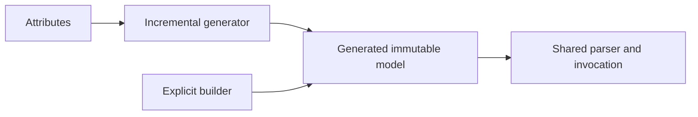

# FEAT-11: Declarative API and Generation

## Status
**ACTIVE**

## Capability
Generate validated command models and typed handler bindings from explicit
declarations, with the same parser behavior available through the builder API.

## Context
Depends on [FEAT-01](FEAT-01-Command-Model.md),
[FEAT-02](FEAT-02-Options-And-Arguments.md),
[FEAT-04](FEAT-04-Typed-Conversion.md),
[FEAT-07](FEAT-07-Parse-Results-And-Diagnostics.md),
[FEAT-09](FEAT-09-Invocation-Lifecycle.md), and
[FEAT-15](FEAT-15-Directives.md). The API and diagnostic decisions
are recorded in [ADR-010](../Architecture/ADR-010-Declarative-Generation.md).
Converter/enum/union generation extends that decision under
[ADR-015](../Architecture/ADR-015-Converter-Ownership-And-Unions.md).

## Requirements
### FEAT-11-001 - Declarative registration
Attributes declare a root, generic child or parent relationships, options, positional arguments and an optional handler. Names, order and ordinary cardinality are inferred from symbols, source position and property types unless explicitly overridden. The generator emits a `CreateModel` factory and typed construction-time bindings.
**Acceptance:** A nested declaration with prefix-free long names, `ShortName`/`ShortAliases`, short-only options, inferred kebab-case names, typed option and positional argument compiles and invokes its handler; `--arg 1 2 3 --arg 4` binds one ordered collection.
**Security:** Generation uses direct type and method references; it does not scan assemblies or evaluate declaration text.

### FEAT-11-002 - Incremental generation
Use Roslyn incremental generation with stable hint names, deterministic syntax-tree/source-span ordering and updated output when declaration metadata changes.
**Acceptance:** Unchanged input yields identical generated text, changing a command alias updates registration, and members split across partial declarations retain compilation syntax-tree order.
**Security:** Invalid declarations do not produce a usable root model or stale root binding.

### FEAT-11-003 - Explicit-model equivalence
The builder API and generated model share the same definitions, parser and invocation semantics for the supported declaration surface.
**Acceptance:** Equivalent nested generated and explicit models select the same canonical path and return the same handler outcome for the same arguments.
**Security:** Both paths use `CommandModel.Create` validation and the shared parser; generated code cannot bypass model checks.

### FEAT-11-004 - Declaration diagnostics
Reject unsupported class/property/handler shapes, hierarchy cycles anywhere in the declared graph, and hierarchy collisions at the declaration site with corrective diagnostics. Declaring the same edge with both `CliChild` and `CliParent` reports `MCLI003` at both attributes.
**Acceptance:** A bound property without an init accessor and duplicate sibling alias produce errors, and the invalid root receives no generated registration.
**Security:** Diagnostics use stable generator-only IDs and do not include declaration literal values.

### FEAT-11-005 - Generated invocation capability
Generated roots expose a common static model-factory contract; roots whose reachable command trees contain only synchronous handlers additionally expose a synchronous capability contract for compile-time-constrained host entry points.
**Acceptance:** `RunAsync<TCommand>` compiles and runs for any generated root; `Run<TCommand>` compiles for a synchronous tree, including a handlerless tree, and fails C# generic constraint checking when any reachable handler is asynchronous.
**Security:** Capability classification is deterministic over the validated generated command tree and never relies on runtime reflection, async detection, or fallback dispatch.

### FEAT-11-006 - XML documentation metadata
Infer omitted display metadata and shell invocation examples from command, option, positional and OptionPack XML documentation at build time.
**Acceptance:** Command summary/remarks become Description/LongDescription; option and positional summaries become Description; pack summary/remarks become Title/Description. Explicit attribute values, including empty strings and null, win. Ordered shell code examples compile into the same metadata as explicit builders; non-shell examples remain documentation-only. XML-only edits update generated output.
**Security:** Read documentation without expanding external includes or resolving XML entities; do not execute example text or discover documentation at runtime. Invalid shell examples produce MCLI002 and suppress root registration.

### FEAT-11-007 - Requiredness and initializer metadata
Infer option requiredness and positional minimum cardinality from the C# `required` modifier and `System.ComponentModel.DataAnnotations.RequiredAttribute`, and infer typed absent defaults and help display from supported constant property initializers. Explicit `CliOption.IsRequired` and `CliArgument.MinimumValues` take precedence. Directive values retain their separate declaration semantics.
**Acceptance:** A required command or pack property rejects missing input; an optional initializer supplies the same typed default to parsing and the handler and displays it in help. Explicit overrides win, and nonconstant initializers fail with MCLI002.
**Security:** Initializer expressions are not executed during generation, model construction, help or completion. Required defaults are inert, sensitive defaults are never displayed, and unsupported expressions fail without generating an affected root.

## Design
XML documentation is optional. Command `
` and `<remarks>` supply
short and long descriptions; property `
` supplies an option or
positional description; pack `
` supplies its short title and
`<remarks>` its longer description. A named attribute argument is authoritative,
including explicit empty or null values. A missing XML element remains null.
Whitespace introduced by source formatting is normalized; inline code and
references remain plain text and `<para>` preserves paragraph breaks.
External `<include>` and `<inheritdoc>` expansion is not supported.

Command examples use `<example><code>add --text AAA</code></example>`, with
one nonempty invocation line per code element. Omitted `language` defaults to
shell; `language="shell"` is explicit (case-insensitive). Other languages,
including `language="csharp"`, are ignored by help extraction and may contain
multiline or empty code. Multiple shell examples retain XML order. Nested
markup in shell code is rejected; XML-escaped text or CDATA can represent
literal command text. Plain example prose is not an invocation. The runtime
projection and executable/path expansion are owned by FEAT-08-005.

The public declarations live in `Mauve.Cli.Declarations`. Commands are
top-level, non-generic partial classes. Children and members have
source-derived order. A parent can declare `[CliChild<TChild>]` or its child
can declare `[CliParent<TParent>]`; both forms normalize to the same edge.
Sibling edges are ordered by compilation syntax-tree index and the declaring
attribute's span, including mixed forms and partial declarations. A command
edge must not use both forms. Bound command and pack properties are non-static
auto-properties with `get` and `init` accessors; standalone directive values
remain partial get-only properties under FEAT-15. Command types, option properties and positional properties derive
kebab-case names when omitted. A handler is a direct instance method with no
parameters or one `CancellationToken`, and uses a return shape supported by
FEAT-09.

`bool` properties infer BooleanFlag, `IReadOnlyList<T>` options infer the
existing greedy collection mode (which also appends repeated occurrences),
and other option properties infer RequiredScalar. `OptionArity.Counting` is
explicitly selected for `int` and `int?` and requires host syntax configuration
to enable it. Long names and aliases are prefix-free; `ShortName` and
`ShortAliases` declare one-character spellings. A short-name-only declaration
does not infer a long name. Collection positionals
infer `1..N`; scalar positionals infer `1..1`. Explicit option arity and
positional bounds are supported named overrides. Nullable types do not imply
OptionalScalar token syntax.

The generator emits deterministic partial sources and `CreateModel` and
`CreateBuilder` factories for each valid root. It builds ordinary immutable
definitions and uses the runtime model validator. A handler creates a fresh command object for that
invocation and initializes its properties from the validated parse result.
Unavailable optional properties receive their type default; initializer-backed
defaults are already present in the parse result. No application object is
created for parse-only, help or completion operations. Handlers needing
presence or origin can inspect the supplied `CommandInvocationContext`.

The generator recognizes the exact DataAnnotations `RequiredAttribute` and
the C# `required` modifier on options and positionals. A named option
`IsRequired` or positional `MinimumValues` overrides inference even when false
or zero. Scalar and collection positionals otherwise default to minimum one,
so the inferred positional requiredness agrees with existing cardinality.
Property initializers must be compiler-evaluated primitive, enum, string, or
nullable null constants; no initializer expression is executed by the
generator. The constant becomes `DefaultValuePolicy.Constant` and invariant
display text, including `null`. Flag, counting, collection and rest defaults
remain prohibited. Missing optional nonnullable scalar bindings need a nonnull
default; required defaults remain inert. The shared parser and help projection
apply [FEAT-06](FEAT-06-Defaults-And-Validation.md) presence/default rules and
[FEAT-08](FEAT-08-Help-And-Usage.md) sensitive/default suppression.

Each valid root implements `IGeneratedCliCommand`; it also implements
`ISynchronousGeneratedCliCommand` only if all handlers in its complete
reachable command tree return `void` or `int`. A handlerless command does not
make its tree asynchronous. The runtime entry points use these interfaces as
generic constraints, so an async descendant makes `Run<Root>()` a compile-time
error while remaining accepted by `RunAsync<Root>()`.

`MCLI001` identifies invalid command declarations, `MCLI002` invalid members,
and `MCLI003` hierarchy or visible-name conflicts. Unsupported shapes are
compiler errors rather than runtime fallback. Option packs use the same
property-based declaration model: `[CliOption]` marks init-only option
properties on `[CliOptionPack(Title = ..., Description = ...)]` partial
classes. Command and pack constructors declare their nested pack dependencies;
each generated command and pack has exactly one instance constructor, with
parameterless constructors supported and parameters limited to declared pack
dependencies. Required members must be directly declared CLI properties;
inherited required members are unsupported. Unsupported parameter types or ambiguous multiple constructors
produce MCLI002 and suppress root registration. The generator creates fresh
pack instances for each invocation, constructing and binding nested packs
before invoking their parent constructor. A pack's own properties are
initialized after its constructor returns; constructors must not rely on them.
Pack type uniqueness and internal identity
are specified by [FEAT-14](FEAT-14-OptionPacks.md). A root with an instance
method directive still requires a parameterless constructor and cannot have
C# required members: directives can execute before command input is valid.
Standalone directive declarations do not impose that restriction on the root.

Handlers may accept no parameter, a `CancellationToken`, or a
`CommandInvocationContext`. Completion providers are not inferred.
`CliConverter<TProvider>`
on a custom value type automatically registers its static
`ICliValueConverter<T>` provider in reachable roots. On an option, positional
or standalone directive property it is an exact scalar/element override.
`CompletionSafe = true` explicitly permits completion callback execution.
Provider accessibility and exact target agreement are checked with MCLI002.
Roots emit ordinal enum maps, source-union case factories in declaration order,
and typed nullable adapters. Unsupported automatic custom-union discovery and
recursive union metadata suppress the affected root with MCLI002.
Applications may still compose explicit host registries with either model
path, rejecting exact-key conflicts. Prior verification of partial-property
binding is not evidence for the new property shape; observed verification is
recorded in the validation ledger.

## Metrics Impact
**Instruments:** none - source generation adds no runtime instrumentation.

## Verification
`CliModelGeneratorTests.Generate_InfersRequiredAndConstantDefaultsForCommandsAndPacks`,
`Generate_RequiresPositionalWithRequiredModifier`,
`Generate_UsesTypedInvariantConstantDisplaysAndNullableDefaults`,
`Generate_RejectsUnsupportedInitializersAndUnsafeRequiredMembers`, and
`Generate_UpdatesInitializerAndRequiredAttributeEdits` cover FEAT-11-007.
Observed results belong in the validation ledger.

`CliModelGeneratorTests.Generate_CombinesParentAndChildEdgesInGlobalSourceOrder`,
`Generate_UpdatesParentOnlyHierarchyWhenAnEdgeChanges`,
`Generate_ReportsBothDeclarationsOfTheSameEdge`,
`Generate_ConflictingEdgeDoesNotInvalidateAnUnrelatedRoot`,
`Generate_RejectsCyclesAcrossAllDeclaredCommands`, and
`Generate_RejectsInvalidParentTargetsAndRootChildren` cover parent declarations
and hierarchy diagnostics. Observed results belong in the validation ledger.

`CliModelGeneratorTests.Generate_InfersXmlMetadataAndShellExamplesWithExplicitModelParity`,
`Generate_PreservesExplicitXmlMetadataOverridesIncludingEmptyAndNull`,
`Generate_RejectsInvalidShellExamplesButIgnoresOtherLanguages`, and
`Generate_UpdatesXmlOnlyEditsWithStableUnchangedOutput` verify FEAT-11-006.
Observed results belong in the validation ledger.

`Generate_BindsTypeAndPropertyConvertersEnumsAndOrderedUnions` executes
generated custom scalar/collection/nullable binding, definition overrides,
enum maps, union selection, and directive conversion.
`Generate_RejectsMismatchedProvidersAndCustomUnionDiscovery` verifies corrective
MCLI002 diagnostics and suppressed root output.

Generator-driver tests compile and execute nested generated consumers,
compare an invocation outcome with an explicit model, and verify all
supported asynchronous handler return shapes (`Task`, `Task<int>`,
`ValueTask`, and `ValueTask<int>`), parameter forwarding, cancellation and
unsupported async signature diagnostics. They also verify unchanged and
edited output, inferred names/cardinality, cross-file source order, and that
unsupported or colliding declarations suppress root generation. The strict
MTP suite records the observed results in the validation ledger.
`CliModelGeneratorTests.Generate_ConstrainsSynchronousEntrypointToSynchronousCommandTrees`
verifies both host entry points for synchronous roots and compiler rejection
of `Run` when an async handler is present below the root.
The method passed in the strict MTP suite; the repository gate also validated
all generated method-level requirement declarations. See the
[validation ledger](../validation-gaps.md) for observed requirement evidence.

## Diagrams

