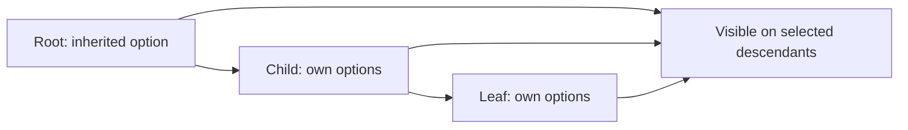

# FEAT-12: Inherited and Global Options

## Status
**ACTIVE**

## Capability
Expose explicitly scoped parent options to descendant commands with
deterministic visibility and conflict handling.

## Context
Depends on [FEAT-01](FEAT-01-Command-Model.md),
[FEAT-02](FEAT-02-Options-And-Arguments.md) and
[FEAT-03](FEAT-03-Token-Grammar.md). The implementation decision is recorded
in [ADR-009](../Architecture/ADR-009-Inherited-Option-Scope.md). OptionPack
members will use the same explicit scope contract when FEAT-14 is implemented.

## Requirements
### FEAT-12-001 - Explicit scope
An option must become visible to descendants only through an explicit inherited/global scope declaration.
**Acceptance:** An inherited root `--verbose` is visible to a nested leaf; an ordinary root-local option is not visible there.
**Security:** Reusing a pack or declaring a parent option must not implicitly grant global visibility.

### FEAT-12-002 - Placement and binding
Bind visible inherited options consistently at approved positions along a selected command path.
**Acceptance:** `--verbose file copy` and `file copy --verbose` bind the same inherited option; an option owned by another command is rejected.
**Security:** Never bind an option from an unrelated command or silently reinterpret its value as a subcommand.

### FEAT-12-003 - Scope conflicts
Validate collisions between all simultaneously visible names and aliases before parsing.
**Acceptance:** A child alias colliding with an inherited parent alias fails regardless of declaration order; reuse on disjoint sibling branches remains valid.
**Security:** Reject shadowing rather than allowing a descendant to intercept a security-relevant ancestor option.

### FEAT-12-004 - Descendant consistency
Expose the same visible definition and value provenance to downstream help, result and invocation consumers.
**Acceptance:** A leaf's help and parse result identify an inherited option once; a nested handler receives its explicitly supplied value.
**Security:** Visibility must not result in duplicate binding, state leakage or unintended disclosure of hidden metadata.

## Design
#### Scope and option order

`OptionScope.Local` is the default. `OptionScope.Inherited` exposes an
option on its declaring command and descendants, but only after that owner
has been selected. An inherited root option is therefore the explicit global
option form. Pack membership does not alter option scope.

For a selected command, effective options are its own options in declaration
order followed by inherited ancestors nearest-first, preserving each
ancestor's declaration order. Local ancestor options are not in a descendant's
effective set. Validate every command's effective names and aliases before
parsing; reject any collision, including hidden options. Disjoint branches may
reuse local spellings.

An inherited ancestor option can appear before, between or after descendant
command tokens, provided its owner has already been selected. A local
ancestor option scanned before descending remains an out-of-scope occurrence
on the final descendant path; it is not rebound. A descendant-local option
before its command is selected is an unknown option. After a positional,
visible options remain recognized until `--`.

Requiredness, defaults, conversion and value validators apply once to the
effective set. Each parsed option retains its declaring owner and source
coordinates. Typed results accept the declaring owner plus definition handle,
or a unique visible option handle. Help projects inherited definitions once
and keeps display groups scoped to their declaring command path. Invocation
contexts expose inherited values without copying them onto the selected leaf.

## Metrics Impact
**Instruments:** none - option scope adds no runtime instrumentation.

## Verification
`CliParserTests.Parse_RecognizesInheritedOptionsOnlyInSelectedScope` covers
local exclusions, provenance and validation;
`CliParserTests.Parse_BindsInheritedOptionsBeforeBetweenAndAfterSelectedPath`
covers valid placements.
`CommandModelTests.Create_RejectsInheritedOptionCollisionsButAllowsDisjointScopes`
covers effective-name conflicts.
`HelpDocumentTests.Create_ProjectsInheritedOptionsWithTheirDeclaringOwner`
and
`CliInvokerTests.InvokeAsync_ExposesInheritedValuesFromTheirDeclaringCommand`
cover help and invocation integration. The package-free harness passed these
methods; this is not product MSTest or Governance acceptance evidence. The
product test run remains blocked by the missing local Governance feed. See
the [validation ledger](../validation-gaps.md).

## Diagrams

