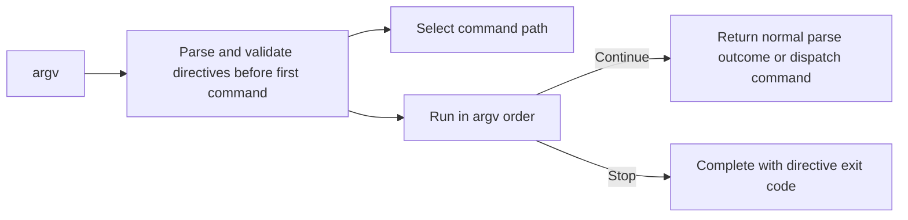

# FEAT-15: Command Directives

## Status
**ACTIVE**

## Capability
Register typed directives on a command model root, parse bracket-delimited
occurrences before ordinary command input, and run their handlers in order
before the selected command handler.

## Context
Depends on [FEAT-01](FEAT-01-Command-Model.md),
[FEAT-03](FEAT-03-Token-Grammar.md),
[FEAT-04](FEAT-04-Typed-Conversion.md),
[FEAT-07](FEAT-07-Parse-Results-And-Diagnostics.md),
[FEAT-09](FEAT-09-Invocation-Lifecycle.md),
[FEAT-10](FEAT-10-Completion.md),
[FEAT-11](FEAT-11-Declarative-Api-And-Generation.md), and
[FEAT-13](FEAT-13-NativeAot-And-Trimming.md). The root-owned pipeline and
stop semantics are recorded in
[ADR-014](../Architecture/ADR-014-Directive-Pipeline.md).

## Requirements
### FEAT-15-001 - Root directive registration
The explicit model and generated model must register ordered, uniquely named
directives on a root and expose each registration to every selected descendant.
**Acceptance:** Two directives retain registration order and are available on a selected leaf; duplicate names and registration on non-root commands are rejected.
**Security:** The runtime does not scan assemblies, instantiate unregistered types, or select an ambiguous directive.

### FEAT-15-002 - Directive span parsing
Parse repeated `[name]` and `[name: values]` spans before the first child
command is selected. Bind bare values to declared directive values in
declaration order, preserve argv coordinates, and validate the complete
directive plan before any directive runs.
**Acceptance:** Flexible spans across argv tokens bind in order before a child command; an unknown, malformed, missing, excess, or unconvertible directive value makes the directive plan invalid and exposes no executable partial plan; ordinary invalid/help outcomes retain a separately validated directive plan.
**Security:** Enforce existing argument/token/model limits, do not log sensitive values, and never reinterpret values inside a directive span as commands or options.

### FEAT-15-003 - Ordered directive invocation
Invoke every validated directive occurrence in command-line order before
handling ordinary invalid/help outcomes or dispatching a command handler.
**Acceptance:** `DirectiveResult.ContinueProcessing` proceeds; `StopProcessing(code)` completes with that exact code, including zero, and suppresses all later directives and the command handler. Cooperative cancellation and unexpected faults follow FEAT-09.
**Security:** Validate all directives before side effects; never dispatch later callbacks after cancellation, a stop result, or a fault.

### FEAT-15-004 - Declarative directive binding
Generated roots can explicitly include standalone partial directive classes
and root methods marked with `[CliDirective("name")]`, using direct generated
bindings and the same runtime definitions as the explicit model.
**Acceptance:** A generated standalone directive binds its ordered values and a root method directive receives the supported handler parameters; generation is deterministic and invalid declarations produce diagnostics without a usable invalid root.
**Security:** Generated dispatch uses direct type references and introduces no runtime reflection or generator dependency.

### FEAT-15-005 - Directive projections and compatibility
Expose safe directive metadata through help, completion, parse results and
invocation contexts, and preserve trimming/NativeAOT behavior.
**Acceptance:** Help and completion show visible directive names/value syntax; hidden and sensitive values are suppressed; generated and explicit NativeAOT scenarios execute registered directives without changing ordinary parsing semantics.
**Security:** Projection APIs never instantiate directives or run handlers; AOT support is claimed only after native publish-and-run evidence.

## Design

The immutable `CommandModel` owns an ordered directive list. Directives are
available across its command tree and are not inherited options: their grammar
is bracketed, their values are bare and declaration-ordered, and their
callbacks run as a separate pre-dispatch stage. A directive occurrence must
precede the first child-command token; it is not recognized after command
selection.

The current grammar accepts a bracket span beginning with `[name` and ending
with `]`. The name may be followed directly by `]` or by `:`; text after the
colon and before the closing bracket is the first value, and subsequent argv
tokens in the span are additional values. The final token's text before `]`
is preserved as a value. Directives are accepted before the first child
command, may appear among root options before command selection closes, and
are not recognized after a child command, positional, or `--`; repeated
occurrences are independent. No shell tokenization or string splitting is
performed.

Parsing produces either a complete validated directive plan or no executable
plan. The parser can retain a valid plan alongside an ordinary
`InvalidInput` or `HelpRequested` outcome. The invoker runs that plan before
returning the ordinary outcome, allowing a directive to short-circuit with
`StopProcessing(0)` or any other exit code. Invalid directive syntax/value
prevents all directive and command handlers from running.

Directive callbacks receive a directive invocation context and use
`DirectiveResult` to explicitly continue or stop. Unexpected callback faults
propagate; caller cancellation maps to the existing `Cancelled` outcome.
Generated standalone directives and root method directives must lower to
these same definitions and invocation semantics. Help and completion operate
on metadata only.

## Metrics Impact
**Instruments:** none - directive registration and invocation add no telemetry.

## Verification
Focused model, invocation, generator, help, completion and AOT scenarios are
declared in the test projects and indexed in the
[validation ledger](../validation-gaps.md). Run `bash scripts/verify.sh` to
validate requirement metadata, build and test the solution, and publish/run
the trimmed and NativeAOT acceptance scenarios. NativeAOT support is claimed
only after that gate records successful generated and explicit directive
execution; ordinary unit tests are not AOT evidence. The repository gate
passed with 99 tests, including the generated and explicit directive scenarios
in both managed MTP and NativeAOT execution on Linux x64.

## Diagrams

