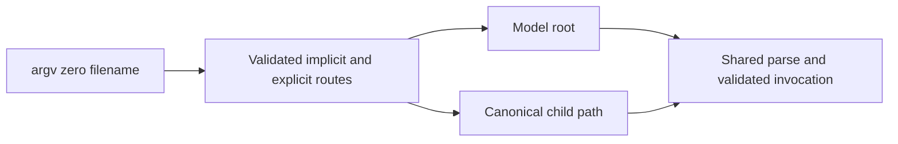

# FEAT-17: Multicall Dispatch

## Status
**ACTIVE**

## Capability
Dispatch one multicall binary to different command models or command paths
using the executable's invocation name, including symlink names.

## Context
Depends on [FEAT-01](FEAT-01-Command-Model.md),
[FEAT-08](FEAT-08-Help-And-Usage.md),
[FEAT-09](FEAT-09-Invocation-Lifecycle.md), and
[FEAT-13](FEAT-13-NativeAot-And-Trimming.md).
The decision is recorded in
[ADR-018](../Architecture/ADR-018-Multicall-Dispatch.md).
A mapped child remains a child in its original model, not another declared
root. Existing generated root/child restrictions remain unchanged.

## Requirements
### FEAT-17-001 - Immutable routes and valid configuration
`CliMulticallRoute` snapshots an executable filename and full command path.
The path starts with a supplied model root name or alias and continues through
child names or aliases under ordinal case-sensitive comparison. All supplied
models and routes must be validated before invocation. Root names and aliases
implicitly register executable routes. Explicit routes add names rather than
overriding implicit routes.
**Acceptance:** `new CliMulticallRoute("smurf", ["tool", "copy"])` targets
the canonical copy command. Later edits to the caller's path do not change
the route. Empty models, null items, malformed names, unknown path segments,
and duplicate platform-normalized executable names fail explicitly, even if
the current executable would select another valid route.
**Security:** Never select an arbitrary handler on conflicting configuration.
Route filenames cannot contain directories or control characters. Model and
route configuration failures occur outside invocation exception mapping.

### FEAT-17-002 - Executable-name selection
`CliInvoker.DispatchMulticallAsync` selects exactly one route using the final
platform-native path segment of `CliHostOptions.ExecutableName`, defaulting to
`Environment.GetCommandLineArgs()[0]`. Windows strips a trailing `.exe`
case-insensitively and compares ordinally ignoring case; other platforms
compare exact ordinal filenames, including extensions. The same normalization
applies to registered executable names.
**Acceptance:** A root or root alias selects its model without an explicit
route. A symlink named `smurf` selects the explicit child route.
Windows `C:\bin\SMURF.EXE` matches `smurf`; Unix `/bin/SMURF.exe` does not.
An unmatched executable throws `InvalidOperationException` and invokes no
directive or command handler.
**Security:** Use the invoked name, not the resolved symlink target or
`Environment.ProcessPath`. No fallback root or process termination is used.
Executable names are routing context, never authorization.

### FEAT-17-003 - Selected-path host semantics
Start parsing at the mapped canonical path while keeping the original model
root and caller argv unchanged. Further child selection, inherited options,
model converters, root directives, environment-prefix derivation, validation,
cancellation, exception mapping, output sinks, and exit codes retain the shared
host semantics. Diagnostics and parsed values retain caller token coordinates.
Help describes the selected command; usage and executable-prefixed `$0`
examples omit the mapped prefix already represented by the executable.
**Acceptance:** `smurf [notice] --count 3` dispatches to `tool/copy`,
executes the root directive first, and binds inherited and local options.
`smurf deeper` selects a descendant. `smurf --help` does not demand
`smurf copy`; malformed argv invokes no handler. Handler contexts expose
canonical ancestry and unchanged `ParseResult.Arguments`. Pre-cancellation
skips parser callbacks; mapped handler faults follow the existing host policy.
**Security:** Do not prepend fake tokens or bypass validation. A child route
cannot access ancestor-local options, move outside its subtree, or bypass
inherited requiredness. Invalid input and help never run command handlers.

### FEAT-17-004 - Model parity and published execution
Explicit and generated models use the same multicall dispatch implementation
without runtime reflection or a generator runtime dependency. Provide paired
examples documenting root names, root aliases, explicit child routes, and
actual symlink invocation.
**Acceptance:** Generated and explicit multicall scenarios execute equivalent
routes in managed and NativeAOT product tests. Both examples execute through
real symlinks after trimmed and NativeAOT publication on Linux x64.
**Security:** Publication evidence must execute the invoked-name routing,
not substitute injected names for the symlink checks. Other platforms remain
unverified until executed; no privileged installation is required.

## Design
`DispatchMulticallAsync(models, routes: ..., arguments: ..., options: ...)`
is a separate async host API. Existing `Run`/`RunAsync` overloads are unchanged.
Each invocation builds and validates its own route table; no process-global
registry or assembly discovery is introduced. Duplicate executable keys,
including duplicates for the same target, are configuration errors.

Paths are arrays of command segments, not space-delimited shell text.
Command aliases resolve to canonical definitions. An explicit root path may
contain only the root segment. Route matching is not child parser matching:
executable normalization is platform-specific, while command paths always use
the model's ordinal rules. Directory components are removed only from the
host's invocation name; registered route names must be individual filenames.

A selected path is internal parser context, not synthetic argv. Its ancestors
continue to determine inherited scope and root-owned configuration. Root
directives remain allowed before the first user-selected descendant,
positional argument, or `--`. Ordinary help projection retains canonical
ancestry for option ownership, but drops the mapped prefix from usage and
executable-prefixed examples. Non-`$0` examples remain canonical text.
Shell-completion registration is not inferred or rewritten; hosts retain the
existing explicit adapter configuration contract.

## Metrics Impact
**Instruments:** none - multicall routing is invocation-local configuration
and adds no telemetry.

## Verification
`MulticallDispatchTests` covers configuration snapshots and failures,
executable matching, canonical selected-path parsing, host policy, and help.
`AotAcceptanceTests.VerifyMulticallDispatch` covers generated/explicit parity.
`scripts/verify-multicall-examples.sh`, invoked by `scripts/verify-aot.sh`,
executes the paired examples through real symlinks.
Observed results belong in the [validation ledger](../validation-gaps.md);
test declarations alone do not constitute passing evidence.
The implementation passed the 206-test Release suite and full local gate,
including six managed and six native AOT tests and real-symlink execution of
both example variants after managed, trimmed, and NativeAOT publication.
The ledger records artifact locations and distinguishes product TRX from
example smoke evidence. Windows and other publication targets remain
unverified.

## Diagrams

