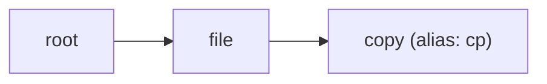

# FEAT-01: Command Model

## Status
**PLANNED**

## Capability
Represent a tree of commands with names, aliases and descriptive metadata,
and select one deterministic command path.

## Context
The [active command model](../FEAT-01-Command-Model.md) owns hierarchy and
definition integrity. This remaining requirement covers argv path selection.
Grammar is specified in [FEAT-03](FEAT-03-Token-Grammar.md). Project
boundaries are in [ADR-001](../../Architecture/ADR-001-Project-Boundaries.md).

## Requirements
### FEAT-01-003 - Deterministic path selection
For valid input select a root-to-command path using declared names or aliases; preserve the canonical selected command regardless of spelling.
**Acceptance:** `file cp` selects `root/file/copy` when `cp` aliases `copy`; a missing child does not silently select a different sibling.
**Security:** An unknown routing token or ambiguous name must not invoke a fallback command; intentionally declared positional binding follows the explicit precedence below.

## Design
#### Proposed model contract

The following is a concrete proposed baseline, not an approved public API.
The model contains immutable definitions, never current invocation values.
Each command has a canonical name, ordered unique aliases, short/long
descriptions, hidden visibility, ordered children, ordered local option and
positional definitions, ordered pack inclusions and at most one handler
descriptor. Identity is the definition's canonical path, not its alias or
display description. The root name labels help/path output; argv excludes
the executable name and does not have to repeat the root name.
Canonical paths are immutable sequences of components, not unescaped
slash-joined dictionary keys; slash notation in examples is explanatory.

Propose ordinal case-sensitive lookup for command and option names. `copy`
and `Copy` are distinct. Command names/aliases match
`[A-Za-z0-9][A-Za-z0-9-]*`, are at most 128 characters, and cannot be empty,
contain whitespace, `=`, a slash, or start with `-`. Do not trim or normalize
input to make a child name match.
The root is a display label, not a routing token: allow any nonempty name
without whitespace/control characters, up to 128 UTF-16 code units, including
`Mauve.Cli` and `my_tool`. The stricter grammar above applies to children and
their aliases, not that label. Descriptions may be empty; output escaping is
owned by FEAT-08.

Validate a complete snapshot before token routing or application callbacks
(public API argument/bound checks are specified in FEAT-07).
Build one map over all siblings' canonical names and aliases and reject
every duplicate key, including canonical/canonical, alias/alias and self-alias
repetition. Hidden commands participate identically and are selectable by
exact names/aliases; hidden only suppresses help/completion, never authorization.
Detect cycles by reference identity on the
active traversal stack. Reject attaching the same command definition under
two parents: canonical ancestry must be unique. Two independently constructed
definitions with equal names on disjoint branches are valid. Freeze/copy
builder collections so mutation after validation cannot change the snapshot.
Runtime model-validation failures and generator diagnostics describe the
same violated invariant; FEAT-07 owns runtime diagnostic representation.
Apply FEAT-07's 64-level depth and total-definition bounds before descending;
use an explicit traversal stack or check depth before recursive calls.

#### Selection algorithm and boundaries

Start at the root and retain its canonical definition in the selected path.
While command selection is open, a bare token matching a child name/alias
selects exactly that child. A consumed option value is not a command token.
The first positional token or `--` closes command selection permanently;
options may still be recognized after a positional until `--`.
The token walker and final option visibility checks belong to FEAT-03/12.
Do not scan the remaining vector to find a deeper command.

A command with both children and positionals intentionally gives an exact
child match precedence, then binds a nonmatching bare token as a positional.
Thus `file cpoy` may legitimately run `file` with argument `cpoy` if that
positional was declared; the parser cannot infer a typo. This is not a
fallback for an unknown routing token. Authors wanting typo rejection on
a command group must omit its positionals. Add both model shapes to tests.

If a command has no positional definitions and an unmatched bare token
occurs while selection is open, classify it as `UnknownCommand` when children
exist, otherwise as an excess positional. Neither case dispatches an
ancestor handler. A command may have both a handler and children; no child
token means its own handler may be selected. A command without a handler
remains a valid definition; FEAT-09 owns its non-invocation outcome.

#### Examples and future assertions

Fixture: root `tool`, child `file`, grandchild `copy` with alias `cp`;
`copy` declares one `source` positional. Input examples are token arrays.

| argv / definition | Expected result |
| --- | --- |
| `[]` | Selected path contains only `tool`; dispatch is a separate operation. |
| `["file", "cp", "input"]` | Canonical path `tool/file/copy`; positional `input`; alias spelling does not rename the command. |
| `["file", "cp", "cp"]` | Last token is the source value, not removed merely because it equals an alias. |
| `["File"]` | Unknown command under the proposed comparison on the root without positionals; no fuzzy selection. |
| `["--", "file"]` | Root selected; `file` is a root positional/excess token, not a child. |
| Siblings `copy` and `move` with alias `copy` | Invalid model before any parse callback. |
| A command references itself, or a descendant references an ancestor | Invalid cycle with bounded diagnostic context. |

#### Source extraction and approval boundary

Maz supplies ordered command/alias metadata and case-insensitive child
lookup. Its parser can later skip a token by comparing its text to selected
command names. This design instead records consumed token indices, so
repeated text is not lost. Maz's mutable command instances are not a
requirement for this library.

Approval is still needed for name syntax/comparison and the proposed model
snapshot shape. Public builder/class names are deliberately unspecified.
All owned behavior is described here; the maz paths are historical provenance,
not required implementation reading. Implement definition validation first,
then exercise selection through FEAT-03 rather than a second parser.

## Metrics Impact
**Instruments:** none - planned model behavior adds no runtime instrumentation.

## Verification
Future model and parsing tests should cover aliases, nested paths, empty names,
comparison boundaries, duplicate siblings and cycles. No test has been run
for these planned requirements.

## Diagrams

