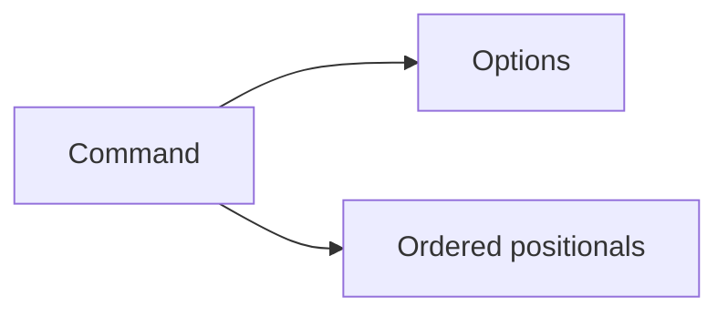

# FEAT-02: Options and Arguments

## Status
**PLANNED**

## Capability
Define named options and ordered positional arguments with metadata and
validate definitions before parsing.

## Context
Depends on [FEAT-01](FEAT-01-Command-Model.md). Syntax belongs to
[FEAT-03](FEAT-03-Token-Grammar.md), cardinality to
[FEAT-05](FEAT-05-Cardinality-And-Special-Forms.md). Reference evidence:
`../maz/Console/Cli/CommandDef.cs` and `../maz/specs/CLI Parser Specification.md`.

## Requirements
### FEAT-02-001 - Option definitions
Options must define a canonical name, zero or more aliases, a value type and descriptive/visibility metadata.
**Acceptance:** A `--output` option with `-o` alias and hidden metadata is discoverable in the model through either name; empty or malformed names are rejected.
**Security:** Hidden metadata is a presentation choice, not access control; untrusted descriptions are never executed.

### FEAT-02-002 - Positional definitions
Commands must define named, typed positionals in a stable declaration order, with descriptions and visibility metadata.
**Acceptance:** Declaring `source` then `destination` retains that order; duplicate or empty positional names fail validation.
**Security:** Invalid definitions fail before input is bound rather than assigning a value to an unintended argument.

### FEAT-02-003 - Local alias integrity
All option names and aliases visible on one command must be unique under the selected comparison rule, including names within a single definition.
**Acceptance:** Two local options using `-o`, or one repeating its own alias, are rejected independent of declaration order.
**Security:** Duplicate aliases cannot redirect an input to an arbitrary option.

### FEAT-02-004 - Declaration consistency
Definition validation must reject positional orderings and type/cardinality combinations that cannot be parsed unambiguously, including a non-final rest argument.
**Acceptance:** A rest argument followed by another argument is rejected; a final rest and a command with no positionals are accepted.
**Security:** Malformed metadata must fail closed without partial binding.

## Design
#### Definition schema

The proposed semantic schema is independent of builder/attribute names:

| Definition | Required information |
| --- | --- |
| Option | Stable owner/definition identity; canonical long name; ordered alias records `(spelling, Normal or Negating)`; value/element type and explicit AllowsNull flag; syntax mode; required-presence flag; converter reference; defaults/bare behavior; validators; visibility; sensitivity; description/value label; local/inherited scope. |
| Positional | Owner identity; unique display name; declaration index; value/element type; minimum/maximum token count; converter; default/validators; visibility/sensitivity; description; optional static/provider completion metadata. |
| Display-only metadata | Safe default text and allowed-value labels; these do not supply a default, enforce validation, or read an environment variable. |

Propose a canonical long option name matching
`--[A-Za-z][A-Za-z0-9-]*`. Aliases use that grammar or one ASCII letter
after a single dash, such as `-o`; names are at most 128 characters including
dashes. Reject `--`, `-`, embedded whitespace/`=`, repeated aliases,
multi-character short aliases and numeric short aliases. FEAT-01 owns the
ordinal case-sensitive comparison. Neither declaration order nor a hidden
flag permits duplicate visible names.
Canonical names must be long-form; short-only options are not in this
baseline. Repeated/trailing hyphens inside an otherwise valid long name
are allowed literal characters (`--a--b`, `--a-`); they imply no new grammar.
Helper-installed options, including FEAT-08 help, use this same collision
checker. They are reserved only when explicitly installed.

Syntax mode is one of BooleanFlag, RequiredScalar, OptionalScalar,
RepeatedSingleCollection or GreedyCollection (FEAT-05). A Negating alias
is a long-form, boolean-only alias on the same BooleanFlag identity, not a
second option. Each OptionalScalar must specify a bare constant, factory or
explicit nullable-null policy; missing bare behavior is an invalid model.
AllowsNull is explicit for programmatic reference definitions and derived
from supported annotated declarations for generated ones, never guessed
through runtime reflection. It is independent of syntax mode and requiredness.
BooleanFlag has intrinsic true/false semantics; an explicit value-converter
override on that mode is InvalidModel, and registry bool converters do not
override flags. RequiredScalar<bool> remains an ordinary converted value
when custom boolean vocabulary is wanted.

Positional names match command-name syntax but are diagnostic labels, not
tokens a caller types before their values. Reject duplicate positional names
within a command. An option and positional may share a display label because
their identities/kinds differ. Expose kind in diagnostics so they cannot be
confused.

#### Arity and integrity

Keep required presence, nullable value type and token arity separate.
`Required=true` demands an occurrence; it does not decide whether that
occurrence is bare, scalar or multi-value. Nullable is a conversion/binding
property, not implicit optional-value syntax. FEAT-05 defines accepted forms;
FEAT-06 owns absent and bare defaults.

Supported positional shapes are required scalar `(min=1,max=1)`, optional
scalar `(0,1)` and final rest `(0,unbounded)` or `(1,unbounded)`.
Allow at most one rest, and no required positional (including required rest)
after an optional scalar. Non-rest min is 0 or 1 and max is exactly 1; only
rest has unbounded max, with min 0 or 1. Reject other tuples such as `(2,3)`.
Non-final rest or negative/inverted arity is invalid. Binding uses declaration
order; optional arguments cannot be skipped by their name.

Collection option declarations distinguish repeated single-value occurrences
from greedy multi-value occurrences. A scalar cannot declare a collection
element converter; a collection must have a supported element converter and
fresh result storage. Do not equate any arbitrary `IEnumerable<T>` with a
constructible mutable collection. The initial proposed public result shape
is a read-only sequence of typed elements; user-specific collection
construction needs an explicit binder.

Freeze definitions before parsing. Validate names, arities, converter
availability, duplicate defaults, incompatible flag/negation modes and
unconstructible generated bindings before running callbacks.
Validate flattened packs and inherited names at their owning FEAT-14/12
integration points using the same invariant checker, not last-wins dictionaries.

#### Worked declaration cases

| Metadata | Validity / meaning |
| --- | --- |
| `--output`, alias `-o`, scalar string | Either spelling addresses one definition; a value token is required unless OptionalScalar mode with explicit bare behavior is declared. |
| Nullable integer with ordinary scalar arity | `--count` still needs a value; nullability alone changes no token rule. |
| `--verbose`, boolean flag, alias `--no-verbose` marked negating | Explicitly declared opposite-valued alias; not name-prefix inference. |
| Required `source`, optional `destination` | Bind zero/one destination after source; missing source is invalid input, not an invalid definition. |
| Optional `source`, required `destination` | Invalid definition rather than guessing which omitted position was intended. |
| Final rest `paths` with minimum one | Accept one or more remaining positional tokens; zero is a missing required argument. |
| Hidden `--output` plus visible alias `-o` on a second option | Invalid collision; hidden is not a separate namespace. |

#### Source extraction and open decisions

Maz stores values and `WasProvided` on option objects, uses mutable help
group metadata and a narrower positional type path. This library instead
keeps immutable definitions and per-parse values, and uses the same typed
conversion pipeline for options and positionals. Maz's environment-variable
display metadata does not establish a generic config-provider feature.

Approve name syntax, positional ordering and collection result shape before
implementation; exact builder/attribute spelling remains an API design
decision. FEAT-11 must lower declarations to this schema without adding
different inference rules. No maz source is needed to implement this contract.

## Metrics Impact
**Instruments:** none - planned definitions do not add runtime metrics.

## Verification
Future definition tests cover aliases, malformed names, duplicate and
case-boundary names, ordering, hidden metadata and invalid rest positions.
No tests have yet established product behavior.

## Diagrams

