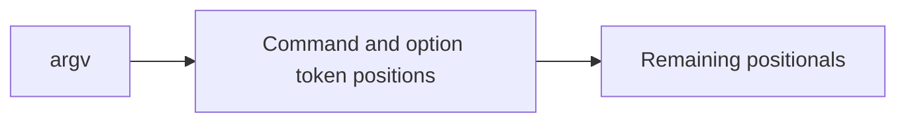

# FEAT-03: Token Grammar

## Status
**PLANNED**

## Capability
Interpret an already-tokenized argument vector consistently, including
command paths, option forms and the end-of-options marker.

## Context
Depends on [FEAT-01](FEAT-01-Command-Model.md) and
[FEAT-02](FEAT-02-Options-And-Arguments.md); value cardinality belongs to
[FEAT-05](../FEAT-05-Cardinality-And-Special-Forms.md). Reference:
`../maz/Console/Cli/Parsing/CliParser.cs` and
`../maz/CliGenerator.Tests/CliParserBehaviorTests.cs`.

## Requirements
### FEAT-03-003 - Command and option ordering
Track consumed token positions when resolving the command path and binding inputs, so equal text elsewhere is not mistaken for a command.
**Acceptance:** For child `copy`, `copy --name copy` keeps the second `copy` as the option value; an option before a child consumes its required value only once.
**Security:** Selection must not change based on duplicate text in a value or skip validation of an unconsumed token.

## Design
#### Input and state

Proposed baseline: accept an argv sequence excluding the executable name.
An empty sequence is valid. An empty string is one token; do not strip
quotes, expand response files, split whitespace, substitute environment
variables, glob paths or recognize bracket directives. Reject a null vector
or null element as an API argument error, not an empty successful invocation.
FEAT-07 defines limits and diagnostic coordinates.

Maintain a current canonical command path, a command-selection-open flag,
an end-of-options flag, an ordered occurrence list and each consumed token's
original index. Classification is by position, never by subsequently
comparing text against selected names. This prevents a positional or value
named `copy` from disappearing after selecting the `copy` command.

#### Proposed left-to-right algorithm

1. Perform FEAT-07 API/bound checks and validate/freeze the model before
   routing tokens or callbacks. Start at the root.
2. Before end-of-options, recognize exact `--`; consume it and permanently
   close option and command recognition. All subsequent tokens, including
   another `--`, are positional.
3. Before that marker, a token beginning with `-` other than the literal `-`
   is an option candidate. Split only its first `=` into name and value.
   Look up the current command's local options plus inherited ancestors,
   using FEAT-12 scope rules. Never look ahead into descendants to find a name.
4. An unknown option consumes only itself, records an error and does not
   infer the arity of or consume the next token.
5. A known option consumes tokens according to FEAT-05. A required scalar
   accepts a following ordinary token, even if it matches a child command.
   `--` and any other option-like token stop required-value consumption.
   Exception: a numeric option/element accepts a negative-value candidate
   starting with `-` then a digit, or `-.` then a digit; conversion determines
   validity. Thus `-2x` is an invalid numeric value, not a short-option cluster.
   Numeric means FEAT-04's built-in integer/float/decimal target, including
   Nullable wrappers, even if its converter is overridden; custom target
   types do not gain this lexical category and use equals for dash values.
   The test uses ASCII digits and invariant `.`, not culture-specific signs.
   A boolean flag consumes a following true/false token ignoring case before
   child/positional matching, even when it could name a child/path.
6. With command selection still open, an unconsumed bare token matching a
   child name/alias selects it. Otherwise close command selection and collect
   that token as a positional. Once closed, never reopen it. The lone `-`
   is an ordinary positional value, not a special stdin feature.
   A negative-number-like token in a positional slot is still an option
   candidate before `--`; numeric positionals require the marker for negative
   values. On a command with children but no positionals, the first unmatched
   bare token while selection is open is UnknownCommand at that index.
   Otherwise tokens beyond declared positional arity are UnexpectedArgument.
7. Keep recognizing currently visible options after positional collection
   begins until `--`. On completion, reject any previously consumed
   ancestor-local option that is not visible on the final command (FEAT-12).
8. Assign collected positionals to the final command's arguments, preserving
   indices. Then perform conversion/default/validation stages as specified
   by FEAT-04/06. Never dispatch during scanning.

An inline `=` always supplies exactly one value, possibly empty and possibly
containing more equals signs. It never starts greedy multi-value consumption.
Dash-prefixed string values must use `--name=-x` or equivalent short equals
syntax. Missing required values do not consume the stopping option/marker.
Short clusters and attached values such as `-abc`/`-c2` are not inferred.
Unknown-option recovery follows exactly this scan, with no guessed value
arity. For `["--wat","x","copy"]`, `x` closes command selection, so `copy`
does not become a later child. Resulting unknown/excess diagnostics are
intentional deterministic cascades, not a reason to run a fallback handler.
Final-scope rechecking precedes duplicate counting and any conversion;
out-of-scope occurrences are arity-scanned only (FEAT-12).

#### Acceptance matrix

Fixture: root `tool`, inherited boolean `--verbose`/`-v`, inherited scalar
string `--name`, leaf `copy` with integer `--count`/`-c` and final rest
`paths`. `--filter` is an inherited optional-value string.

| argv | Expected interpretation |
| --- | --- |
| `["copy","--name","copy","copy"]` | Select `copy`; name value is second `copy`; last token is one path. |
| `["--name","copy"]` | Root remains selected: `copy` was consumed as a value, not a command. |
| `["-v","copy","a","--count=2"]` | Select `copy`; verbose true, path `a`, count 2. |
| `["copy","-c","-2"]` | Numeric value -2. `-c=-2` is equivalent. |
| `["copy","--name","--wat"]` | Missing name value plus unknown option; never name value `--wat`. |
| `["copy","--name=-x=y"]` | Name value is the single string `-x=y`. |
| `["copy","--name="]` | Explicit empty string, not an absent/bare option. |
| `["copy","--count","--","-2"]` | Missing count value; `-2` is a literal path after the marker. |
| `["copy","--","--","-file"]` | Two paths: literal `--` and `-file`. |
| `["copy","a b",""]` | Two path values, with embedded space and empty string retained. |
| `["--filter","copy"]` | Filter is bare; `copy` is selected, because optional values require equals. |
| `["copy","-v","true"]` | Verbose true, no path named `true`; use `["copy","-v","--","true"]` for that literal path. |
| `["copy","-2"]` | UnknownOption before the marker, even for a numeric positional; use `["copy","--","-2"]`. |
| `["--wat","copy"]` | Unknown option at index 0; `copy` may still be selected, but no invocation is eligible. |

#### Source extraction and pending choices

Maz resolves a path then scans again, comparing token strings against
command names; it can confuse equal text and rejects space-separated negative
values. Its nullable optional values may greedily take a following command.
The position-based walk, numeric exception and equals-only optional values
above are intentional proposed improvements, not compatibility guarantees.
Approve these grammar/ordering choices before coding; the exact cases here
replace any need to consult maz. FEAT-05 owns cardinality; FEAT-12 owns scope.

## Metrics Impact
**Instruments:** none - planned tokenization adds no runtime instruments.

## Verification
Future tests exercise empty tokens, spaces, repeated command text, negative
numbers, equals, unknown options, separator and literal dash filenames.
These are test plans, not observed results.

## Diagrams

