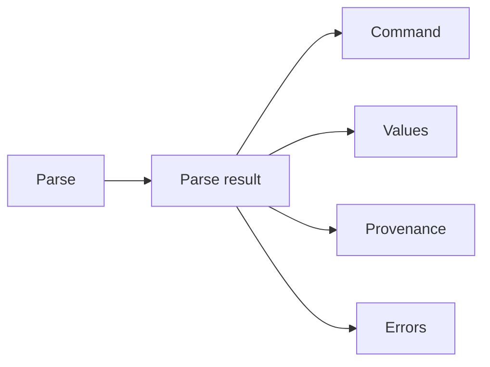

# FEAT-07: Parse Results and Diagnostics

## Status
**PLANNED**

## Capability
Return an inspectable parse outcome with command selection, typed values,
provenance and safe structured errors.

## Context
Depends on [FEAT-01](FEAT-01-Command-Model.md),
[FEAT-02](FEAT-02-Options-And-Arguments.md),
[FEAT-03](FEAT-03-Token-Grammar.md),
[FEAT-04](FEAT-04-Typed-Conversion.md),
[FEAT-05](../FEAT-05-Cardinality-And-Special-Forms.md) and
[FEAT-06](../FEAT-06-Defaults-And-Validation.md). Evidence:
`../maz/Console/Cli/Parsing/CliParser.cs` and
`../maz/CliGenerator.Tests/CliParserBehaviorTests.cs`.

## Requirements
### FEAT-07-001 - Result and provenance
Return the selected canonical command/path and typed values with explicit, defaulted or absent provenance, without mutable state shared across parses.
**Acceptance:** A supplied zero and defaulted zero have equal values but distinct provenance; two parses of the same model retain independent results.
**Security:** Expose values only through caller-controlled result access; do not log them automatically.

### FEAT-07-002 - Structured errors
Return deterministic structured categories and relevant definition/token-position context for malformed definitions, missing values, conversion and validation errors.
**Acceptance:** An invalid integer and a missing value are distinguishable, with stable locations across identical runs; errors prevent successful invocation.
**Security:** Public error details must not include raw secret values or unbounded exception text.

### FEAT-07-003 - Unmatched input
Expose unmatched tokens as failures by default and define any explicit permissive mode without treating unmatched input as recognized.
**Acceptance:** Unknown `--wat` and excess positional input fail by default; a documented opt-in can inspect unmatched tokens without invoking as though they were valid.
**Security:** Never silently discard unknown input or leak its contents in default diagnostics.

### FEAT-07-004 - Bounded suggestions
Where suggestions are offered, derive them from visible declared names and limit candidate count and work.
**Acceptance:** A typo near a visible command can yield a bounded suggestion; no close match or an exhausted limit yields none, deterministically.
**Security:** Do not suggest hidden names by default or include sensitive values; bound work for large input.

## Design
#### Proposed result schema

Public type names remain undecided; the semantic contract does not.
A result records its immutable model snapshot identity and outcome kind
(`Validated`, `HelpRequested` or `Invalid`),
canonical selected command/path, ordered diagnostics and unmatched
occurrences. Preserve a defensive copy of argv only through deliberate
caller access; do not expose mutable input arrays as result storage or
automatically log input. Model validation failure has no selected path.
An empty argv against a valid model selects the root.

Each value entry identifies its owner/definition, presence (`Absent`, `Bare`,
`WithValue`), origin (`Absent`, `Default`, `Explicit`), availability/invalid
state and the supplying token indices. Typed value access must distinguish
unavailable from available null/default(T). Definition lookup is by validated
identity/handle, not a global alias dictionary. Reject a handle from another
model. Ordinary typed value retrieval requires a Validated outcome; other
results permit inspection of diagnostics/coordinates, not dispatchable
partially validated objects.
Validated permits unavailable optional entries without defaults, but never
invalid entries. Presence-aware Try access reports unavailable; a direct
getter for an unavailable entry throws a fixed InvalidOperationException
without raw input. HelpRequested has no typed value entries.

Collections exposed as successful results have read-only containers and
parse-local storage. The library does not deep-freeze arbitrary custom
reference values; custom converter/default factory ownership requirements
are explicit in FEAT-04/06. No previous result is mutated by the next parse.

#### Diagnostics, locations and ordering

Proposed semantic categories (not allocated numeric diagnostic IDs):

| Category | Meaning / location |
| --- | --- |
| InvalidModel | Definition collision, invalid arity, missing converter or composition error; definition identity, no invented argv index. |
| UnknownCommand / UnknownOption / UnexpectedArgument | Unrecognized occurrence at its original token index. |
| OptionOutOfScope | Ancestor-local option consumed before descending, but invisible on the final command; original option index. |
| MissingValue / UnexpectedValue | Known option arity violation; option token index. |
| DuplicateOption | A repeated scalar; repeated occurrence plus first-occurrence reference. |
| InvalidValue | Conversion failure; supplied value's index, owning option index when separate, and optional inline offset. |
| MissingRequired | Required option/argument absent; definition identity without a fabricated token index. |
| InputLimitExceeded / DiagnosticLimitExceeded | Explicit bound exceeded; do not silently truncate into success. |

`ValidationFailed` is defined by active FEAT-06; this feature specifies
additional result coordinates and deterministic ordering for diagnostics.
Coordinates are zero-based argv indices, excluding the executable/root name.
For `--count=x`, both option/value index are that token and the value offset
is the UTF-16 code-unit index after its first `=`. Defaults have no token coordinates.
Descriptions/messages contain safe declared names and bounded reason text,
not raw values, exception messages or `ToString()` of application objects.
Raw unmatched text is available only through explicit caller inspection,
never automatic safe-message formatting.
Callback validation failures supply a bounded reason identifier (at most
64 ASCII letters/digits/dot/underscore/hyphen), not display text. The default
formatter uses only its own category templates and safe declared names,
not application reason identifiers/messages. Application-provided reasons
are inspectable by the caller, which owns any custom presentation/redaction.
Malformed/oversized callback reason identifiers are callback contract faults,
not truncated or rendered strings; throw a fixed InvalidOperationException
without including their content.
Hidden definition names are replaced by a generic label in default display;
their canonical identities remain available to explicit caller inspection.

Order model errors by deterministic definition traversal. Diagnostic phases
are: structural scan/scope/duplicate errors by token index; conversion
InvalidValue errors by supplying-token index; MissingRequired in effective
definition order; per-value ValidationFailed in definition/registration
order; cross-value ValidationFailed in registration order. Use ordinal
category name as a same-index tiebreaker. FEAT-06's stage gates still apply:
structural errors suppress conversion; missing-required/conversion errors
suppress defaults/value validators, not an interleaved validation stage.
One missing value plus an unknown
following option may produce two diagnostics. An invalid supplied value
does not additionally become MissingRequired: occurrence and validity differ.
Unexpected callback exceptions propagate as application faults, rather than
being mislabeled as user-input errors or successful defaults.

#### Bounds and unmatched behavior

Proposed default limits, checked before allocating/calling providers:
4096 argv tokens, 16384 UTF-16 code units per token, 1048576 total code units,
64 combined command/pack nesting levels, 4096 effective options on one command
and 10000 normalized command/pack-inclusion/option/argument nodes across a
snapshot (count reused inclusions separately).
Configure positive lower/higher limits explicitly on the model/settings;
limit failures remain failures. Cap diagnostics at 64 entries: if a further
ordinary error occurs after 63, use the final entry as DiagnosticLimitExceeded.
These are proposed safety values, not measured performance claims.
Null argv is an API argument error before parsing. Check count before
enumerating elements; an over-count vector returns Invalid/InputLimitExceeded
at the first excess index (4096 by default) without reading it. Otherwise
inspect tokens left-to-right: an encountered null element is an API argument
error; an overlong token or aggregate-size violation stops at that offending
index. Input-limit outcomes have no selected path and run no routing/callbacks.
Model-depth/node/option violations are InvalidModel with definition context
and no argv index, also without a selected path. Check depth before descent.

Strict parsing fails on all unmatched occurrences. Strict mode is the initial
required surface; no permissive forwarding mode is approved. A future inspection-only
mode may retain them for tooling, but must remain ineligible for invocation;
this is not pass-through command execution. Do not implement shell execution
or forwarding simply because an unmatched list exists.

Suggestions are advisory only: inspect at most the first 256 visible
canonical names/aliases in declaration order, compare at most 128 characters
per name/input, use ordinal comparison and bounded edit distance at most two,
and return at most five unique canonical candidates. Prefix matches are
eligible even when full edit distance exceeds two. Rank prefix matches,
then distance, then canonical ordinal name. Do not inspect hidden names or
emit suggestions when the input-length bound is exceeded. A suggestion never
changes selection or success.
UnknownCommand pools only the current command's children; UnknownOption
pools the current effective option names/aliases. No suggestions are emitted
for out-of-scope options, conversion/positional errors or arbitrary values.
Attach canonical candidate identities/spellings in a structured Suggestions
field, not interpolated typo text. All limits apply before matching/dedup.

#### Test fixtures and extraction

Assert categories/coordinates/provenance independently of localized wording.
Cases include explicit/default zero, available-null versus missing,
`["--count=x"]` offset, value/command text repetition, unknown secret-like
tokens absent from formatted messages, deterministic cap overflow, cross-model
handles, and parsing the same model concurrently with different inputs.

Maz returns mutable string errors/unmatched text and stores values on option
instances. Those details are deliberately replaced by structured safe
outcomes and per-parse storage. Its fuzzy suggestions are not an execution
fallback. Approve schema semantics, bounds, ordering and advisory matching
before implementation; no external source is necessary to fill in behavior.

## Metrics Impact
**Instruments:** none - planned results introduce no runtime metrics.

## Verification
Future tests cover provenance, independent parses, category/order stability,
unmatched input, hidden suggestions and size bounds. No observed test runs
or active traceability are asserted.

## Diagrams

