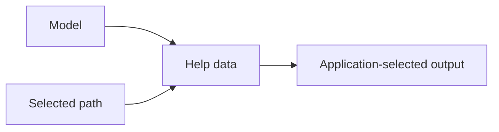

# FEAT-08: Help and Usage

## Status
**PLANNED**

## Capability
Produce useful, customizable help from command and argument metadata.

## Context
Depends on [FEAT-01](FEAT-01-Command-Model.md),
[FEAT-02](FEAT-02-Options-And-Arguments.md),
[FEAT-06](../FEAT-06-Defaults-And-Validation.md), and
[FEAT-07](../FEAT-07-Parse-Results-And-Diagnostics.md). Pack grouping is
provided by [FEAT-14](FEAT-14-OptionPacks.md); its composition rules are
not owned here. Reference: `../maz/Console/Cli/CommandDef.cs` and
`../maz/Console/Cli/OptionPack.cs`.

## Requirements
### FEAT-08-001 - Usage metadata
Render root and selected leaf usage from the model, including names, aliases, arguments and requiredness.
**Acceptance:** Root help lists visible children; leaf help identifies positional order and option aliases; an empty command still has valid usage.
**Security:** Render metadata as inert text and never invoke handlers to produce help.

### FEAT-08-002 - Visibility and defaults
Honor hidden metadata and display declared default information only when safe and explicitly permitted.
**Acceptance:** A hidden option is absent from ordinary help; an explicitly displayable non-sensitive default appears, while a sensitive default does not.
**Security:** Never evaluate a default factory merely to render help or reveal secret values.

### FEAT-08-003 - Grouping and customization
Support application-supplied output customization and pack group metadata without changing parse semantics.
**Acceptance:** Two pack groups render separately in stable order; a custom output sink receives the same model-derived information.
**Security:** No terminal control sequences from untrusted metadata may be emitted unsafely by default.

### FEAT-08-004 - Help precedence
Specify whether help bypasses requiredness and validation and how it interacts with malformed or unknown input.
**Acceptance:** Under the proposal, leaf help works without required inputs, but malformed definitions and unknown options still produce failure; no handler executes.
**Security:** Help must not mask malformed models or transform a failed parse into an invocation.

## Design
#### Proposed help model and rendering

Separate a pure `HelpDocument`-like data projection from text rendering;
the name is illustrative, not approved API. Input is a validated immutable
model plus a canonical selected path and help-display settings.
Data includes canonical usage path, descriptions, visible child summaries,
ordered positionals, visible local/inherited options with aliases and
value labels, safe declared default/allowed-value text, and stable pack
group identities/titles/descriptions. Do not construct command/pack instances
or invoke handlers, converters, default factories, validators or providers.

Proposed plain-text ordering: usage; short/long description; visible children
in declaration order; positionals; flat option groups ordered by their first
member's appearance in FEAT-12's effective definition order. Ungrouped options
belong to an owner-specific ungrouped group, not one global group moved before
all packs. Preserve effective order within each group. Grouping may move
separated members together; effective order is presentation input, not a
strict global rendered sequence. A scalar required positional is `<source>`, optional is
`[destination]`, rest is `<paths...>` or `[paths...]` according to minimum.
Options display aliases together, with `<value>` for required arity and
`[=<value>]` for optional-value syntax. State that optional values require
equals; do not imply a space form the parser rejects. Required-presence
options are marked explicitly, regardless of default display.

Group identity is its declaring owner/inclusion path and stable group key,
not title text. FEAT-14 owns
membership and inner-versus-outer precedence. Never duplicate an inherited
option in a descendant's help. `Hidden` suppresses discoverability, not
parsing; default values marked sensitive remain suppressed in all display
modes, including explicitly supplied display-only default/allowed-value
strings and sensitive positional metadata. A display permission never
overrides sensitivity. An inert default on a required definition is not
displayed as effective (FEAT-06). Advanced-only help is not initial scope; do not import maz's
`--help-more` or tree-filter modes without separate approval.

Text output is deterministic and independent of ambient terminal width.
Default width is proposed as 80 columns, configurable explicitly; test
at narrow and ordinary widths without depending on OS newline conventions.
Sanitize every display field before constructing the public projection:
remove C0/C1/DEL control characters (including ESC/CSI/NEL), Unicode line/
paragraph separators and bidi control characters. Titles/labels become
single-line; normalize description CRLF/CR to LF and preserve LF only as
plain paragraph boundaries, removing other controls. Renderers wrap plain
text explicitly and never interpret embedded ANSI/Markdown. A custom
renderer receives already sanitized/sensitivity-filtered data, not a raw
metadata escape hatch. Fail a throwing output sink explicitly;
do not report successful display after a write fault.

#### Help request and error precedence

Rendering an explicitly selected command's help is separate from recognizing
a help option in argv. Propose an opt-in standard-help installation that
adds one inherited root boolean `--help`/`-h`; reject registration collisions
instead of silently overriding application flags. The token must set help
true; `--help=false` or `--help false` is an ordinary false flag value, not a help request.
`--help` after `--` is a positional. No automatic help subcommand is implied.

Scan and resolve the complete argv with ordinary grammar/arity first.
Resolve this helper's true/false literals intrinsically, case-insensitively,
without an application converter: `--help=maybe` is InvalidValue, repeated
help is DuplicateOption, and negating/value syntax obeys FEAT-05. Its boolean
literal check is the sole built-in value check needed before help bypass;
it never invokes user callbacks and cannot be overridden by their converters.
If there is a true help occurrence and no structural input/model errors,
return a distinct `HelpRequested` outcome for the selected command, bypassing
all conversion, requiredness/defaults and application validators.
It is error-free help, not a validated result eligible for invocation.
Malformed model, unknown option/command, excess positional, missing option
value, duplicate scalar and out-of-scope options still fail; help never
repairs their token structure. Invalid conversion text is not converted on
the help path and therefore does not prevent help.

| argv / condition | Proposed outcome |
| --- | --- |
| `copy --help`, required source omitted | Leaf help; no requiredness error or callbacks. |
| `copy --count=bad --help` | Leaf help; numeric converter is not called. |
| `copy --count --help` | MissingValue for count; no successful help outcome. |
| `copy --wat --help` | UnknownOption; do not hide the typo. |
| `unknown --help`, root has children and no positionals | UnknownCommand; no successful root help. With a declared positional the word can bind intentionally (FEAT-01). |
| `copy --help=maybe` / `copy -h --help` | InvalidValue / DuplicateOption, never HelpRequested. |
| `copy --help FALSE` | Normal parse with help false; ordinary missing-required checks still apply. |
| `copy -- --help` with a rest path | Literal path; normal requiredness/conversion applies. |
| Explicit safe default text but a throwing default factory | Help may display that static text without calling the factory. |
| Hidden or sensitive option in extended custom output | Hidden excluded; sensitive actual and display-only default/allowed-value text never supplied. |
| Retry child pack flattened before Network own options | Retry group precedes Network; inherited ungrouped root options do not jump ahead of local groups. |

#### Extraction and approval

Maz predefines several help options and groups pack options in a renderer
that also serves its application UI. Only metadata-derived usage/grouping
is carried forward; renderer/config/environment services are excluded.
Approve helper installation, layout, width policy and the precise bypass
precedence above. All required help semantics are here and in the linked
pack/grammar owners; inspecting maz is unnecessary.

## Metrics Impact
**Instruments:** none - planned help does not introduce runtime metrics.

## Verification
Future snapshots and behavioral tests cover root/leaf usage, aliases, hidden
and sensitive metadata, group order, customization and help/error precedence.
No passing help evidence is asserted.

## Diagrams

