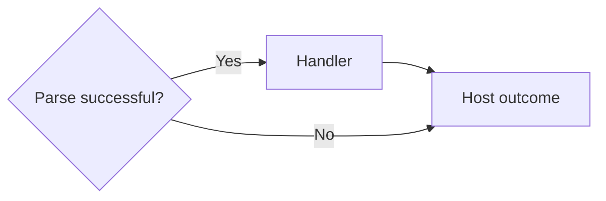

# FEAT-09: Invocation Lifecycle

## Status
**PLANNED**

## Capability
Invoke a selected handler with validated inputs, cancellation and explicit
exit/exception responsibilities.

## Context
Depends on [FEAT-07](../FEAT-07-Parse-Results-And-Diagnostics.md); validation
is owned by [FEAT-06](../FEAT-06-Defaults-And-Validation.md). Reference:
`../maz/Console/Cli/CommandDef.cs`. Application-specific confirmation
and exception formatting are not inherited from maz.

## Requirements
### FEAT-09-001 - Validated dispatch
Invoke only the selected command handler and only after a successful parse and validation.
**Acceptance:** A valid leaf invokes its handler once with the corresponding values; a missing required input or unknown token invokes none.
**Security:** Never execute a fallback handler on malformed input or validation failure.

### FEAT-09-002 - Synchronous and asynchronous handlers
Support synchronous and asynchronous handlers with equivalent input and outcome semantics.
**Acceptance:** Equivalent sync and async handlers receive the same values and yield the same application-provided exit code; a command with no handler is handled by a defined non-invocation outcome.
**Security:** No fire-and-forget handler may outlive a reported successful invocation.

### FEAT-09-003 - Cancellation
Pass the caller's cancellation signal to asynchronous handlers and expose cancellation without reporting success.
**Acceptance:** A pre-cancelled invocation does not run the handler; a cooperating running handler observes cancellation and yields Cancelled.
**Security:** Do not dispatch further library-owned stages after observing cancellation; arbitrary handler side effects cannot be forcibly stopped or rolled back.

### FEAT-09-004 - Host ownership
Return or propagate a documented outcome, including application exit codes and handler exceptions; the reusable core must not terminate the process.
**Acceptance:** A handler returning a nonzero code preserves it; a thrown exception propagates to the host without calling process exit.
**Security:** Default reporting must not expose exception secrets; the host owns safe presentation and termination.

## Design
#### Proposed dispatch contract

The initial high-level operation accepts a validated model, argv and a caller
cancellation token. It performs a fresh parse for each invocation; a public
dispatch-existing-result API is not initially required. This avoids
accidentally reusing mutable custom values/command objects across invocations.
Parsing alone never executes handlers or command constructors.

Dispatch stages: check cancellation; parse; return invalid/help outcome when
appropriate; check cancellation before construction; check the selected
command's handler; construct its new bound
command/pack views; check cancellation again; call exactly one handler;
await it completely; return its supplied exit code. Do not invoke ancestor
handlers before/after a leaf, implicitly choose the first child, or run a
root fallback when input is invalid. No-handler is distinct from invalid
input: an error-free command group is valid metadata but cannot be executed.

Propose one internal asynchronous dispatch representation. Sync void handlers
normalize to completed exit code 0; sync `int`, `Task`/`ValueTask`, and
`Task<int>`/`ValueTask<int>` normalize consistently. Handler signature
selection must be explicit or uniquely validated at generation/model time;
unsupported multiple handlers are invalid definitions, not overload guessing.
An async void handler is unsupported because completion/faults cannot be
observed. FEAT-11 owns declarative method support and compile-time diagnostics.
FEAT-09 owns the semantic signature set: a declarative instance method takes
no parameters or one CancellationToken, for any supported return shape.
It reads bound values through its instance; arbitrary option/pack/DI
parameters are unsupported. The explicit model registers an equivalent
delegate receiving a typed binding context and CancellationToken.
FEAT-11 only validates/lowers these shapes and directly invokes the method.

#### Outcomes, exceptions and ownership

| Semantic outcome | Host responsibility |
| --- | --- |
| Completed with integer exit code | Preserve the exact code, including nonzero; the host decides process-code portability/range policy. |
| InvalidInput with parse diagnostics | Present safe diagnostics; never run a handler. |
| HelpRequested with projected help | Render to an explicit host sink; never invoke. The core need not write automatically. |
| NoHandler with selected path | Host may show usage, but the library does not invent a successful application exit. |
| Cancelled | Distinct from success; host chooses mapping (for example 130), not a hardcoded process exit. |

Unexpected converter/default/validator/constructor/construction-delegate/
binder/handler exceptions propagate
to the host with their original identity/stack; do not catch everything and
return zero or print arbitrary exception text. The core does not translate
application authentication/HTTP failures, prompt for confirmation, install
Ctrl+C handlers, dispose caller services or call `Environment.Exit`.
No process exit code is assigned to a propagated fault.

Cancellation is cooperative. A pre-cancelled call runs no parse callbacks or
handler. Synchronous parse callbacks do not receive a cancellation token in
this baseline; the high-level operation checks the token between parse
stages/callbacks and before/after construction. Standalone synchronous Parse
is not cancellable. Never claim to interrupt an executing callback.
An OperationCanceledException associated with a requested caller
token (or another token when caller cancellation is already requested)
becomes Cancelled; an unrelated OCE without caller cancellation is a fault,
not automatically success/cancellation. Once the handler has been entered,
normal completion wins: preserve its exact code even if the caller requested
cancellation in the meantime. Only a cooperating cancelled handler yields
Cancelled; a non-OCE fault propagates even after a cancellation request.
Late cancellation cannot erase completed side effects or their exit code.
Never claim to undo side effects or forcibly stop a noncooperative handler.

The host retains ownership of caller-owned services and cancellation sources.
Any library-created scope/view must be disposed exactly once if it owns
resources; simple bound values are not automatically disposed merely because
they implement IDisposable. No background work may be reported as completed
while its handler is still running.
Constructed commands/packs and user values are not automatically disposed
merely for implementing IDisposable. Only an explicitly owned operation
scope is disposed, in a finally after awaiting the handler, on normal,
faulted or cancelled paths (including a construction failure after scope
creation). Await asynchronous disposal. If both body and cleanup fault,
preserve both in a documented aggregate rather than hiding the body fault.

#### Acceptance scenarios and extraction

Test a counter proving one selected handler call and zero ancestor calls;
sync/async equivalent return values; InvalidInput/HelpRequested/NoHandler;
pre-cancelled tokens before a throwing factory; cooperative cancellation in
a blocked handler; late cancellation versus completed result; unrelated OCE;
exact propagated exception identity; and two concurrent high-level invocations
using fresh command and pack instances.

Maz has an async integer handler and wraps application-specific confirmation,
Azure authentication and HTTP exceptions. Those wrappers are not parser
behavior. Approval is required for the proposed supported signature set,
outcome types and cancellation race policy; this text replaces source
consultation, not the necessary public API review.

## Metrics Impact
**Instruments:** none - planned invocation adds no runtime instrumentation.

## Verification
Future tests exercise invalid dispatch, both handler forms, pre/running
cancellation, no handler, nonzero results and exceptions. No test runs are
claimed.

## Diagrams

