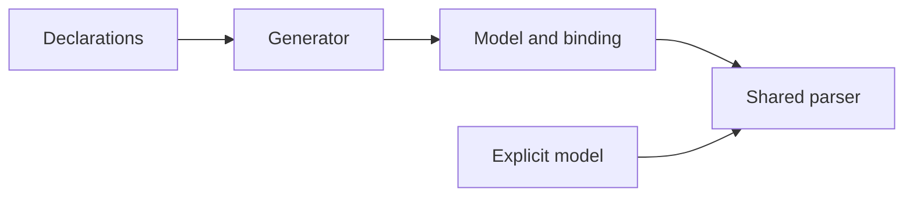

# FEAT-11: Declarative API and Generation

## Status
**PLANNED**

## Capability
Make a declarative, source-generated model and binding the primary path,
while supporting an explicit programmatic model with equivalent semantics.

## Context
Depends on [FEAT-01](FEAT-01-Command-Model.md),
[FEAT-02](FEAT-02-Options-And-Arguments.md),
[FEAT-04](FEAT-04-Typed-Conversion.md) and
[FEAT-07](../FEAT-07-Parse-Results-And-Diagnostics.md). See
[ADR-001](../../Architecture/ADR-001-Project-Boundaries.md). Evidence:
`../maz/CliGenerator.Tests/CompletionTreeGeneratorTests.cs` and
`../maz/Console/Cli/CommandDef.cs`. No runtime assembly scanning is required.

## Requirements
### FEAT-11-001 - Declarative registration
Provide supported declarations for commands, options and arguments that generate registration and typed binding at compile time.
**Acceptance:** A representative nested declaration produces compilable registration and binding; unsupported declaration shapes produce actionable compiler diagnostics.
**Security:** Generated code must not execute untrusted model text or rely on runtime discovery of arbitrary assemblies.

### FEAT-11-002 - Incremental generation
Use incremental generation so changes to relevant declarations update their generated artifacts without stale or nondeterministic bindings.
**Acceptance:** Re-running unchanged input yields equivalent output; changing an alias updates its registration and a generated consumer still compiles.
**Security:** Invalid input must not leave stale generated behavior that appears valid.

### FEAT-11-003 - Explicit-model equivalence
Support a programmatic model capable of expressing the same supported behavior as the generated model, with the same parser semantics.
**Acceptance:** Equivalent generated and explicit models yield the same path, values, provenance and error categories for valid and invalid argv cases.
**Security:** Neither path may bypass validation, conflict detection or safe error handling.

### FEAT-11-004 - Declaration diagnostics
Report malformed, ambiguous or unsupported declarations at their source location when determinable, with corrective guidance.
**Acceptance:** A duplicate alias and unsupported member shape fail compilation with actionable diagnostics; valid declarations do not produce those errors.
**Security:** Diagnostics must not embed sensitive literal values; avoid partial registration after a generator error.

## Design
#### Proposed declaration lowering

Public attribute/base/builder names are not approved. The initial proposed
supported semantic surface is deliberately bounded:

| Declaration | Proposed shape / generated responsibility |
| --- | --- |
| Command | Top-level, non-generic, non-static partial class; explicit canonical name/aliases/metadata; generate a model descriptor and invocation binder. |
| Hierarchy | Explicit ordered inclusion of child declaration types in a root registration, not discovery of every class by name/inheritance/namespace. |
| Option/argument | Annotated accessible partial get-only instance property; generate typed read access from the current binding. No writable/static/indexer/ref-return members. |
| Pack | Explicit typed pack inclusion with stable member/key identity; generate composition and safe binding descriptors per FEAT-14. |
| Handler | At most one explicit method, signature from FEAT-09 (no parameters or one CancellationToken); generate a direct instance call using bound properties. |
| Converter/provider/default factory | Explicit statically addressable method/delegate/factory reference; validate signature/accessibility at compile time. Never emit Activator/reflection lookup. |
| Manual extension | Explicit registration of immutable definitions, appended at a defined point and validated with generated definitions before parsing. |

Initial declaration classes require an accessible parameterless constructor
or an explicitly registered construction delegate. Do not silently use a
service locator or DI container. Construct application command/pack objects
only for a successful invocation; model/help/completion metadata is static
data and must not require those constructors.
Generate an instance-scoped binding slot, attached exactly once after
construction and before any handler/pack-property access. Never use an
ambient/static current result. Getters before attachment (including from
constructors/field initializers) throw a fixed InvalidOperationException;
constructors must not read bound properties. Each instance exposes
presence-aware binding access in addition to typed getters; unavailable
entries differ from available null and direct unavailable getters throw
per FEAT-07. Exact companion accessor names require API approval.

Generate factory/call wrappers inside the owning partial class, with direct
`new`/method/delegate references and assembly-accessible generated descriptor
entry points. A private constructor/handler accessible from that partial is
legal; diagnose accessibility from the actual emitted call site, not a
blanket private-member ban. No UnsafeAccessor/reflection escape is implied.
Require the repository's C# 15 language setting (partial properties need
C# 13+); diagnose user-written implementing partial getters or unsupported
declaration shapes. Generator-driver compiler dependencies must understand
the selected language version before claiming C# 15 fixture coverage.

All declarations lower to FEAT-02's schema and FEAT-06's presence/default
rules. Nullability does not infer optional token arity. A nonnullable bound
option/argument property must have required successful input or a declared nonnull default;
otherwise issue a diagnostic rather than generating `null!` or silently
returning default(T). Nullable optional declarations may explicitly lower
absent/bare-null policies; flags and collection helpers lower explicit
false/empty defaults. Such desugaring must be identical and inspectable
through the explicit model.
Read reference nullability from semantic annotations: reject oblivious
annotated CLI members instead of guessing. Nullable<T> and annotated nullable
references lower explicit AllowsNull=true. Optional nullable entries without
an absent policy remain unavailable, not automatically null; the companion
presence API distinguishes them from bare/default/explicit null. All
successful bare policies must satisfy a nonnullable binding too; required
definitions' inert absent defaults do not prove binding safety.

There is no partial-property initializer syntax assumed by these documents:
defaults are declared metadata or explicit factory references. Parse source
syntax/semantic symbols, never copy an arbitrary initializer/expression into
generated code as untrusted text.

#### Generator algorithm and diagnostics

Use syntax filtering followed by semantic symbol validation and an immutable
intermediate model with structural equality. Deduplicate partial declarations
by symbol identity. Resolve fully qualified types/attributes and root
inclusions; validate collision/type/arity invariants shared with runtime
validation before emitting registration.

Require explicit unique nonnegative order metadata within every semantically
ordered generated list (positionals, own options, child/pack inclusions and
validator registrations). Source path/span is only a deterministic diagnostic
tiebreaker, never a way for a file rename to reorder positional binding or
callbacks. Append manual entries after generated entries of the same owner
list in registration-call order; reject manual/generated collisions naming
both owners. An explicit model expresses that normalized sequence directly.
Do not depend on syntax-provider,
dictionary or filesystem enumeration order. Stable hint names derive from
fully qualified symbol identity with deterministic escaping/hash, not simple
class name or absolute build-machine path. Emit escaped C# identifiers and
string literals, including keywords, quotes, slashes, newlines and Unicode.
Use fully qualified references to avoid ambiguous consumer usings.

Report source-located errors for nonpartial/generic/nested unsupported types,
unsupported members, inaccessible constructors/callbacks, duplicate visible
names, missing converters, invalid arity, nullability/default mismatch,
ambiguous handlers and pack cycles. Diagnostics identify the violated
invariant and correction without embedding sensitive default literals.
Allocate stable generator-only identifiers in an ADR/catalog before coding;
do not reuse Governance MGTEST/MGLOG IDs or runtime parse categories.

On invalid declarations, emit no usable root registration/binding for the
affected root and every root transitively including it, and fail compilation
with an error. Independent valid roots may still emit complete output, but
the compilation still fails; no invalid root gets partial registration.
Stop emitting that root's hint sources when declarations become invalid/
deleted, so the compiler driver excludes prior generated syntax trees.
Stale files emitted for inspection under obj are not compiler inputs and
must never be globbed back into the build or counted as a valid cached build.
Use structurally equatable value/string records, not retained ISymbol/
Compilation objects; keep diagnostic locations separate from semantic cache
keys. Thread cancellation through transforms and honor
incremental-driver cancellation.

#### Required test matrix and extraction

Compile and execute generated consumers, not merely string-search output.
Fixtures cover nested command registration, aliases and token consumption,
both option and positional conversion, required/default/nullability rules,
custom converters, nested packs, inherited scope and help/completion metadata.
For each behavioral fixture build an equivalent explicit model and compare
canonical path, values, origin, diagnostics/coordinates and invocation outcome.
If a later feature is not implemented yet, keep that parity scenario planned,
not a skipped passing claim.

Generator-driver tests must include unchanged reruns, editing/removing an
alias/member, valid-to-invalid transitions, unrelated-file edits, two types
with the same simple name, multi-file partial declarations, escaped names
and literals, nullable-enabled compilation, and generated-source compilation
with strict diagnostics. Verify incremental tracking where the test API
supports it; unchanged final text alone does not prove incremental caching.
Include a nullable/nonnullable presence table covering absent, bare-null,
explicit nonnull, explicit empty and runtime null-returning factories.
Add an AOT fixture whose constructor/handler/converter are rooted only by
generated factory references, and a multi-file rename test preserving all
explicit semantic orders.

Maz emits partial getters, option/pack/child enumeration, converter lambdas
and a completion tree, and uses required/optional inference from types and
initializers. This plan transfers the generation use cases, not its namespace,
runtime base classes, naming conventions or inference quirks.
Approve the declaration matrix and names/diagnostic namespace before coding.
Implement generation for base definitions first; integrate packs after the
FEAT-14 explicit descriptor contract, avoiding a design dependency cycle.

## Metrics Impact
**Instruments:** none - planned generation adds no runtime metrics.

## Verification
Future generator-driver tests compile generated source, exercise incremental
changes and invalid declarations, and compare generated/explicit behavioral
fixtures. None has run for this feature.

## Diagrams

