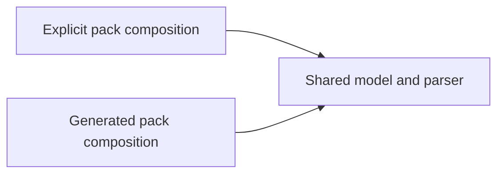

# FEAT-14: OptionPacks

## Status
**PLANNED**

## Capability
Provide generated pack declarations and equivalent generated/explicit
composition behavior.

## Context
The explicit pack descriptor and invocation view are active in
[FEAT-14](../FEAT-14-OptionPacks.md). Generation depends on
[FEAT-11](../FEAT-11-Declarative-Api-And-Generation.md).

## Requirements
### FEAT-14-003 - Generated and explicit parity
Support equivalent generated and explicit-model pack composition and typed value access.
**Acceptance:** Equivalent nested packs created through each path bind the same values and reject the same duplicate alias; generated declarations compose with explicit options under a documented order.
**Security:** Neither construction path bypasses definition validation or converter registration rules.

## Design
Select pack declaration syntax and generated binding accessors before coding.
Generated order must follow the explicit inclusion contract in
[ADR-011](../../Architecture/ADR-011-OptionPack-Composition.md). The generator
must preserve pack inclusion identity and must not emit mutable pack values
into static fields.

## Metrics Impact
**Instruments:** none - generated pack composition adds no runtime instrumentation.

## Verification
Future tests compile and execute generated pack consumers, compare them with
explicit models, and verify collision behavior. No generated pack parity is
implemented or claimed.

## Diagrams

